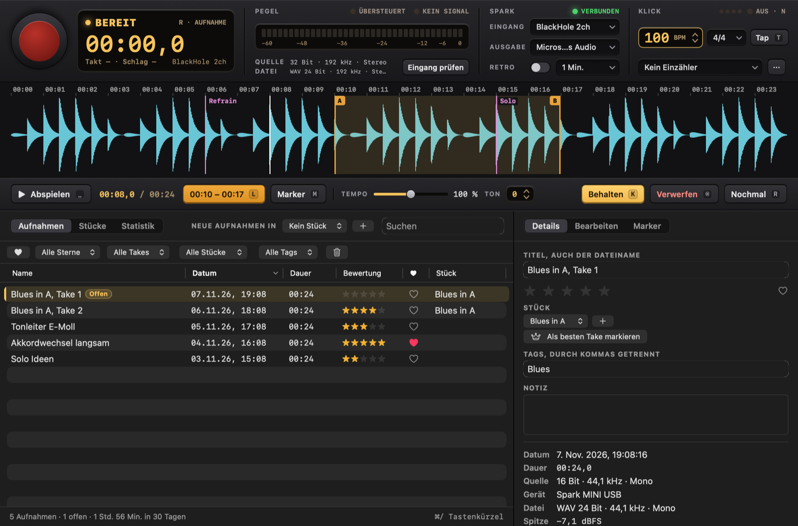
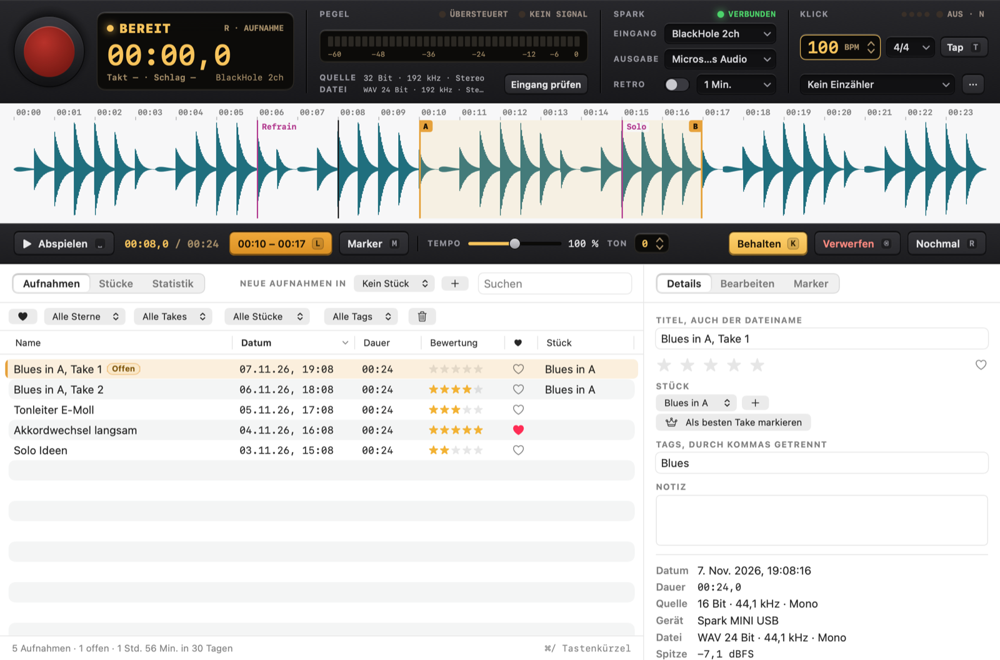
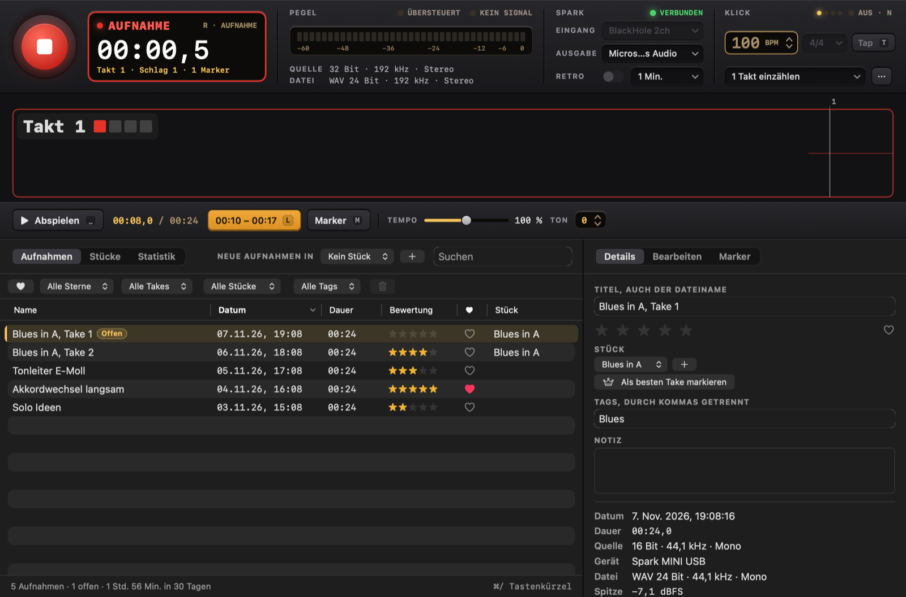
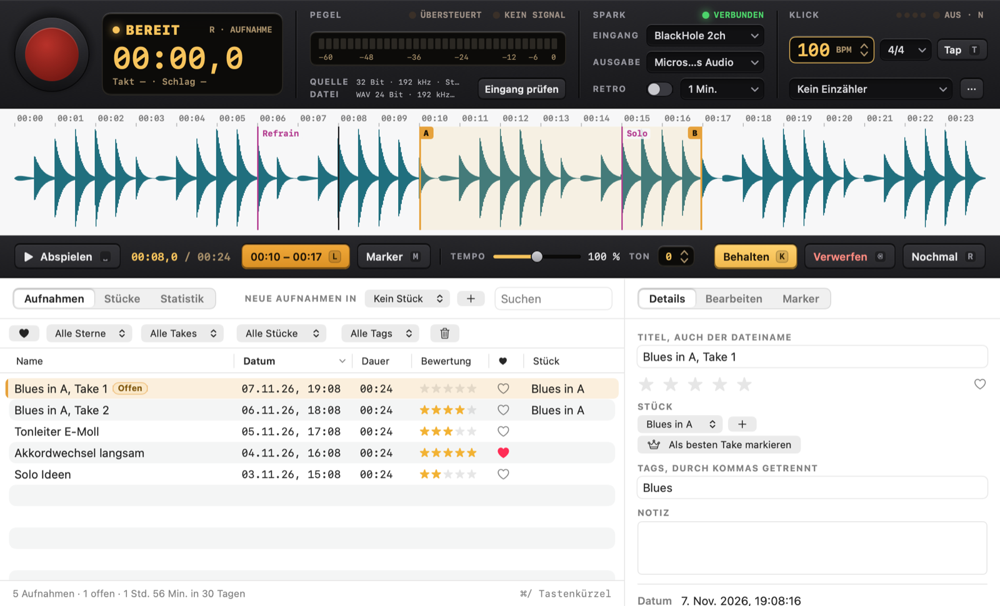

# Spark Recorder

A native macOS recorder for guitar practice: record, listen right away, decide, keep practicing, in a few seconds and
without the mouse. It was built for the Positive Grid Spark Mini.

It only records from a USB device with "Spark" in its name. Without one it records nothing: no microphone, no other input
and no automatic fallback. Pulling the cable closes the input, and plugging it back in starts nothing by itself.

Everything stays on this Mac. The app makes no network connections and has no telemetry.

## Build and run

```bash
./build.sh                    # builds "build/Spark Recorder.app" and "build/Spark Presets.app"
./build.sh --install          # also copies them to /Applications and adds them to the Dock
./build.sh --install presets  # only Spark Presets ("recorder" for only Spark Recorder)
```

Requires macOS 14 or later and the Swift toolchain from Xcode. There are no external dependencies. The build signs with
an Apple Development certificate if one exists, because macOS then keeps the microphone permission across rebuilds.
Without one it uses an ad-hoc signature. `SPARK_SIGN_IDENTITY` overrides the choice, and `-` forces ad-hoc.

## Keyboard

| Key | Action |
|---|---|
| `R` | Start or stop recording, also "Nochmal" |
| `Space` | Play or pause. During a recording it stops it and plays the new take right away, during the count-in it cancels |
| `L` | Loop: first press sets A, second sets B, third removes it |
| `M` | Marker, also during a recording |
| `K` | Keep the take |
| `⌫` / `⌘⌫` | Discard the selected takes: they go to the Trash, the next take in the list is in focus, and `⌘Z` brings them back. Not while recording or typing |
| `←` `→` | Jump 5 seconds, with `⇧` 1 second |
| `-` `+` | Slower or faster |
| `0` | Reset tempo and pitch |
| `1` – `5` | Rate |
| `F` | Favorite |
| `B` | Switch take while comparing |
| `N` / `T` | Click on or off, heard only while playing or recording / tap tempo |
| `G` | Save the retro buffer ("Das eben war gut") |
| `⌘F` / `⌘E` | Search / rename |
| `Esc` | Leave a text field |

Single keys do nothing while you type in a text field. Only `⌫` removes anything, and only to the Trash, undoably. `⌘/` shows this list.

## Where things are

```
~/Music/Spark Recorder/
  *.wav                  Recordings. They are the originals and are never rewritten.
  Bibliothek.json        Metadata: names, ratings, tags, notes, takes, markers, edits. Plain, readable JSON.
  Bibliothek.backup.json The previous version of that file.
  Exporte/               Default folder for exports. It is not part of the library.
  .wellenformen/         Waveform cache. Safe to delete, it is rebuilt when needed.
  .aufnahme-laeuft.json  Exists only during a recording, for crash recovery.
```

Files placed in the folder are picked up on the next start or with "Ordner prüfen". Files renamed in the Finder keep
their metadata. A missing file keeps its entry and is marked. Older recordings are adopted unchanged, with no gain and
with an unknown source, because what happened to them before is not known.

## Recording safety

- The input runs on its own AUHAL unit. The realtime code is in C (`Sources/CSparkRT`) and does not lock, allocate or
  block. Playback, analysis and the UI have no way to stall it.
- Audio is written continuously. If the app crashes, the next start repairs the file's header and adds the take, with
  its markers. Repair only changes size fields in the header, and the audio bytes stay as they were. A file that cannot
  be repaired stays where it is and gets reported.
- A lost device or a sample rate changed by another app ends the recording safely and keeps what was recorded. If the
  input just stops delivering, the app warns but keeps the file open, in case the device returns.
- Recordings stop safely when the disk is nearly full and just below the 4 GB limit of the WAV format.
- A running recording continues when the window closes. The Dock icon then shows REC and brings the window back.

## Feedback and the click

Whether the amp's USB input also carries its USB output is not assumed. While recording, playback and click are blocked
on outputs of the same hardware as the input. The click
picks a safe output on its own. "Aufnahme → Rückkopplung messen" plays quiet clicks and checks whether they arrive at the
input. Only a measurement can unlock a pair of devices, and it counts for exactly that pair.

The click has no code path into the recording, so the app cannot write it to a file.

While playing, the click is mixed into what plays and goes to the playback output. It follows the take's bars, or the
metronome's tempo from the start of a take without bars, and it never reaches a file or an export. While recording, it
runs on its own unit on the click output. A count-in always sounds, even with the click switched off.

## Bars

A recording with a count-in or with the click switched on knows its bars. The window shows the current bar and beat
while recording, and the waveform shows bar lines, also afterwards. Tempo and meter stay fixed during a recording, because
the bars rest on them.

## Timing of click and bars

The bars are meant to be as exact as in a DAW, well under a millisecond on the app's side:

- The click runs on the input's clock. Its beats lie on input frames, and every output block is placed by its host
  time stamp, so click and input never drift apart, even on two devices with separate clocks and for any length of
  take. The file and the count-in gate are counted in the same input frames, so bar 1 lies exactly where it should.
- The latencies the devices report are added: output latency of the click device and input latency of the amp,
  each as device plus stream latency. The safety offset is already part of Core Audio's time stamps and is not added.
- What the amp does inside, in its converters and effects, no device reports. "Aufnahme → Klick-Latenz messen" plays
  clicks through a cable from the click output into the amp's guitar input, the way a played note travels, and
  measures where they land in a temporary file. It refuses a result when the clicks are missing or spread more than
  2 ms. The result counts for exactly that pair of devices and for recordings made afterwards. It can also be set by
  hand in the metronome details, in steps of 0.5 ms.

### Measuring the latency

The Mac's headphone output is a 3.5 mm jack and the amp's guitar input is 6.3 mm, so the cable needs both ends: a
3.5 mm stereo to 6.3 mm mono cable, or a 3.5 mm cable with a 3.5 mm to 6.3 mm adapter. The click plays on both
channels, so the left one is enough.

1. Unplug the guitar and connect the cable from the headphone output to the amp's guitar input. Keep USB connected.
2. On the amp, choose a preset without delay, reverb and noise gate, and turn the master volume down.
3. Set the Mac's volume to about half.
4. In the metronome details, the click output must be the headphone output ("Externe Kopfhörer"). "Eingang prüfen"
   and retro recording must be off.
5. Choose "Aufnahme → Klick-Latenz messen …" and "Messen". It takes about ten seconds.
6. Unplug the cable and plug the guitar back in.

Without a cable, a wired headphone or earbud held directly on a pickup works too. The pickup picks up the speaker's
magnetic field without any delay of its own, so the click then takes exactly the way a played note does. Mute the
strings, turn the Mac up and use a preset with some gain. The neck pickup and single coils give the strongest signal.

The result is stored for the input and the click output it was measured with. The internal delay of the amp is most of
it, so for another click output, such as the built-in speakers, the same correction can be set by hand.

On the BlackHole loop test, every beat lands within one sample of the grid.

Dragging over the waveform of such a take selects whole bars, and `⌥` selects freely. The bar controls below the transport
loop the chosen bars or record them again. Recording bars again counts in at the tempo and meter of the take, stops by
itself shortly after the last bar and creates a recording of its own, such as "Take Takt 5-8.wav". It keeps the bar
numbers and the piece of the take. The original stays as it is, and the two are not merged.

## Audio quality

- The device runs at its highest rate up to 192 kHz during a recording, and its previous rate comes back afterwards.
- Files are always WAV with 24 bits. A 16-bit source stays lossless and gains headroom for editing, but no extra detail.
  The window therefore shows source and file separately, and nothing is labeled "Hi-Res".
- On the tested amp, the USB descriptor offers one channel at 16 bits and 44.1 kHz for capture. Higher quality from the
  amp needs a different signal path, such as its line out into an audio interface.

## Edits

Trim, fades, gain and automatic level are stored in the library and applied when listening and exporting. Automatic
level raises the peak to -1 dBFS with one constant gain of at most 30 dB. Dynamics stay intact and the noise floor rises
with it. Only an export writes a new file, and it refuses to replace the original.

## Retro recording

Off by default. While on, the input stays open and the display says "HÖRT MIT". The last minutes are held in memory only
and never reach the disk on their own. "Das eben war gut" saves them. Turning it off, losing the device, closing the
window or quitting erases the buffer.

## Amp control over Bluetooth (experimental)

The amp's sounds are controlled over Bluetooth LE, not over USB: its USB side offers only audio and volume keys.
`spark-probe` is a test tool for that control channel, and [Spark Presets](#spark-presets) is the app built on it.
Spark Recorder itself still makes no Bluetooth or network connections.

```bash
swift build --product spark-probe
.build/debug/spark-probe scan          # look for the amp
.build/debug/spark-probe info          # firmware, name, current preset number, the playing and the 4 stored presets
.build/debug/spark-probe preset 2      # switch to stored preset 2, like the preset button
.build/debug/spark-probe watch 30      # print what the amp sends, e.g. when its preset button is pressed
.build/debug/spark-probe try 3         # play a renamed copy of stored preset 3 without storing it
.build/debug/spark-probe store-test 4 backup.json        # store a renamed copy in slot 4, then put the original back
.build/debug/spark-probe persist-test store 4 backup.json  # leave a renamed copy in slot 4 …
.build/debug/spark-probe persist-test check 4 backup.json  # … and after switching the amp off and on, check it
.build/debug/spark-probe live 4 script.txt  # play a copy of slot 4 without storing it and run live changes on it
.build/debug/spark-probe backup folder      # write the four stored presets to JSON files
.build/debug/spark-probe catalog-check amp Twin 8  # try 8 amp models from "Twin" on, on the temporary preset
```

A `live` script has one command per line: `param <place> <index> <value>`, `toggle <place> on|off`,
`model <place> <model id>`, `sweep <place> <index> <from> <to> <steps> <ms>`, `wait <seconds>`, `read`, `resend`,
`say <text>` and `raw <command> <sub> <hex bytes>`. A place is 1 to 7 or a model id. After `read`, the probe compares
what the amp plays with what the script sent. The comments in `Sources/SparkProbe/LiveScript.swift` have the details.

`--raw` also prints every byte, `--no-header` sends without the block header, `--no-input` leaves the input byte out
of live changes. The Spark app on the phone and Spark Presets must be disconnected, because the amp takes only one
control connection. macOS asks once for Bluetooth access for the terminal app. The tool shows only devices with
"Spark" in their name and only counts the others.

### What is checked on the amp

Positive Grid does not document the protocol. This follows community reverse engineering (see [Sources](#sources)),
and every line below was checked with `spark-probe` on a Spark MINI with firmware 1.11.2.75.

| Message | What it does | On the Spark MINI |
|---|---|---|
| Service `FFC0`, write `FFC1`, notify `FFC2` | Control channel | Confirmed |
| Block header `01 FE 00 00 53 FE <len> 00…`, chunks `F0 01 <seq> <xor> <cmd> <sub> <7-bit data> F7` | Framing | Confirmed |
| `02 2F`, `02 11`, `02 10`, `02 01` | Read firmware, name, preset number, a preset (`00 <slot>`, or `01 00` for the playing one) | Confirmed |
| `01 01` | Send a preset in chunks of 25 bytes, one Bluetooth write each. `05 01` per chunk, `04 01` at the end | Confirmed |
| `01 38` | Switch preset, `7F` is the temporary one. Ack `04 38` | Confirmed |
| `01 04` | Set a parameter: `len A0+len <model id>`, index, `CA` float, input byte `00`. No ack | Confirmed and heard, with and without the input byte |
| `01 15` | Effect on or off: model id, `C2`/`C3`, `00`. Ack `04 15` | Confirmed by reading back |
| `01 06` | Change a model: old id, new id, `00`. Ack `04 06` | Confirmed by reading back. The amp loads its own start values for the new model |
| `03 38` | The amp's preset button | Confirmed |
| `03 37`, `03 15` | The amp reports parameter changes and on/off | Seen only as echoes of the probe's own changes, see below. The MINI's guitar and music volume knobs report nothing |
| `03 71` | Sent by the amp now and then, probably power and battery | Seen, not decoded |
| `03 64`, `03 65` | Probably tuner reading and tuner on/off | Seen, not checked |

More findings:

- **Stored presets survive switching the amp off.** A copy stored in slot 4 was still there after switching off and on.
- **The temporary preset ends with the connection.** After the control connection closes, the amp plays the stored
  preset that was selected last. A stored slot that was selected stays selected.
- **The preset's end holds a checksum.** After the effects come, on stored slots, two floats (loudness, 9990 meaning
  not set, and extra gain, 0.5) and a byte that is the sum of all bytes after the two place bytes, modulo 256. The
  playing preset has only the checksum. Every one of the 5 presets read matched this rule. `SparkPreset.encode`
  recomputes the byte, so an edited preset stays consistent, and a preset read from the amp still encodes back to
  exactly the same bytes. An earlier version sent renamed copies with a stale checksum, and the amp played them anyway.
- **The amp keeps two parameters in step with on and off itself:** parameter 2 of the noise gate and parameter 7 of
  the reverb. It also adds reverb parameter 7 when a stored preset without it is played on `7F`.
- **Speed:** 30 parameter changes in a row without any pause arrived. The last value is what plays.
- **Echoes:** In one session, after a fast series of changes, the amp started to answer every parameter change with
  `03 37` and an on/off change with `03 15` instead of `04 15`. A second request for the same change then got no
  answer at all. This did not happen again in a fresh session with the same steps, so its cause is unknown. Both
  forms count as a confirmation, and an answer that stays out is checked by reading the playing preset back.
- The amp sometimes ignores a request, so every request is sent a second time when no answer comes.
- **Too many model changes in a row made the amp hang.** About 40 model changes within two minutes, with no pause
  between them, first brought the echoes above and then silence. The amp no longer reacted to its power button,
  while its Bluetooth still took connections. Unplugging USB, holding POWER for more than 10 seconds and switching it
  on again brought it back, with all four stored presets unchanged. In batches of 8 with a second between changes and
  a new connection per batch, the remaining 34 changes went through without a single echo. `catalog-check` therefore works in
  such batches and stops at the first echo, and Spark Presets spaces out model changes.

### Model catalog

`Sources/SparkControl/Catalog` describes every amp and effect model: its place in the chain, a name and a short
description written for this project, the device it is modeled after as a neutral hint, and what each parameter is
(knob, switch, selector with its values). Names and descriptions are this project's own, not those of the official
app. A model id the catalog does not know still works, with numbered knobs, and so do parameters beyond the ones the
catalog names.

`spark-probe catalog-check` checked the catalog on the Spark MINI: it chose every model on the temporary preset and
read back what the amp played. All 68 freely available models were accepted: 1 noise gate, 5 compressors, 10 drives,
33 amps, 12 modulation effects, 6 delays and the reverb with 9 types. `Models+Defaults.swift` holds the values the
amp chose for each, which the editor uses as start values, and their number is the number of parameters the amp
gives the model. Three models have more parameters than the community sources name (vibrato 3, mini vibe 4, square
tremolo 4), and they appear numbered. The models of the paid Jimi Hendrix add-on are in the catalog but hidden, and
the five that were tried were refused, because the add-on is not unlocked on this amp.

The order of reverb parameters 2 to 5 is disputed between sources. The catalog follows the two that agree (low cut,
high cut, density, length), and a listening test confirmed it: with everything else at its maximum, parameter 3 at 0
made the reverb dull but still long, parameter 5 at 0 made it short.

### Sources

Only the facts of the protocol were taken from these projects, no code. Byte layouts were rewritten and then checked
on the amp.

- Paul Hamshere: [Spark](https://github.com/paulhamsh/Spark), SparkIO, Spark-Parser (Apache-2.0), and
  [Spark-Bluetooth-Message-Format](https://github.com/paulhamsh/Spark-Bluetooth-Message-Format) (no license, read only)
- [Ignitron](https://github.com/stangreg/Ignitron) (BSD-3-Clause)
- [SparkBox](https://github.com/paulhamsh/SparkBox) and kindling-control-spark-amps (GPL-3.0, read only)
- soundshed-app and spark-web (MIT)
- For the catalog also [PGSparkLite](https://github.com/richtamblyn/PGSparkLite) (Apache-2.0) and SparklingTones
  (MIT). Positive Grid's own pages were not copied.

## Spark Presets

A separate app to edit the amp's presets, keep them on the Mac and switch them.

- **Click to hear**: clicking a slot in the sidebar, or `⌘1` – `⌘4`, switches the amp to it and opens it in the
  editor, like the preset button on the amp. A speaker marks what plays. Clicking a preset on the Mac plays it on
  the amp's temporary place, which never touches a slot, and a new preset plays at once. Clicking quickly through
  the list sends only the last one. When the amp's own preset button is pressed, the app follows, unless the editor
  holds unsaved changes.
- **Load meter**: a row of amber segments in the display fills while a preset travels to or from the amp, chunk by
  chunk as the amp confirms or sends them ("LÄDT 9/17"). A switch between slots, a single message, shows a short
  sweep. With "Reduce motion" the sweep is left out.
- **Editor**: the signal chain as a row of pedals with the amp head in the middle. A click on a unit shows all its
  controls below: the model, chosen from the catalog, on and off, and every parameter as a knob, a switch or a
  selector. Knobs turn by dragging (`⌥` for fine steps), with the scroll wheel or the arrow keys (`⇧` for big steps),
  a double click goes back to the model's start value, and VoiceOver can adjust them. `⌃1` – `⌃7` choose a unit,
  `⌃0` switches it.
- **Live**: the first change sends the preset to the amp's temporary place, without touching a slot, and every change
  after it is heard at once. Only the newest value of a knob is sent, one message at a time, and model changes are
  spaced out, because a fast series of them once made the amp hang. After a lost connection the edited state goes
  back to the amp. `⇧⌘L` turns live changes off.
- **Undo, A/B, changed**: `⌘Z` and `⇧⌘Z` undo and redo, a whole knob turn being one step. `⌘B` plays the saved state
  for comparing and back. The display says when something differs from the saved state, and switching to another
  preset asks first.
- **Saving**: `⌘S` saves on the Mac, into the preset's own file or as a new one, `⇧⌘S` under a new name. "Auf Platz N
  speichern" (`⌥⌘1` – `⌥⌘4`) asks first, then reads the slot fresh from the amp and saves it on the Mac as a backup,
  stores the preset, switches to it and reads it back to check it arrived unchanged. If the connection breaks while
  storing, the app checks the slot as soon as the amp is back and says what it holds.
- **New presets** (`⌘N`, `⇧⌘N`, `⌘D`): empty, from five templates or as a copy, with name (at most 31 bytes),
  description and BPM.
- **Auf dem Mac**: presets as files, searchable by name and model. Rename with `⌘E`, `⌘⌫` moves the file to the
  Trash and the banner brings it back.

Presets are readable JSON files in `~/Music/Spark Presets/`, one per preset. Files placed there show up when the window
comes to the front. The app only scans for devices that offer the Spark control service, so it never sees other
Bluetooth devices, and it makes no network connections. The Spark app on the phone must be disconnected, because the
amp takes only one control connection. For the same reason Spark Presets and `spark-probe` cannot talk to the amp at
the same time: whichever starts second keeps searching.

The pedals, the amp and their controls come from the shared design module (see [Design](#design-gestaltung)). They
stay dark in light and dark mode, like hardware, and text on them keeps a contrast of at least 4.5 to 1. Animations
are small and stop with "Reduce motion".

Two options help with checking the app. `--live-selftest <log>` edits a copy of slot 1 on the temporary place
through the same code the window uses, reads back what the amp plays after every step and compares, then switches
back to slot 1. It starts by clicking two slots quickly, so a slot switch and the first change must arrive in order,
and it writes every message sent and received to the log. On the Spark MINI all of its ten checks passed: a first
change, on and off, a fast knob turn, a model change and its undo, BPM, and A/B both ways. `--snapshot <png>` writes
a picture of the app's own window, with `--offline`, `--appearance light|dark`, `--size 900x600`,
`--open template:Lead` (or `saved:<file name>`, `slot:<1-4>`, `empty`), `--focus delay`, `--delay 2` and `--quit`.
`--library <folder>` uses a test folder instead of `~/Music/Spark Presets` and fills an empty one with the templates,
so pictures never show your own presets. These pictures draw the sidebar as a plain list, because the system
sidebar's text does not appear in a picture taken this way.

## Design (Gestaltung)

Both apps speak one design language, "Spark Studio": the instrument stays dark, the desk follows the system, keys
instead of buttons and lamps instead of icons. [docs/DESIGN.md](docs/DESIGN.md) has the principles, every value and
the building blocks of `Sources/SparkDesign`, which both apps use. New views use those blocks; a new color or button
style goes into SparkDesign and DESIGN.md first.

| | |
| --- | --- |
|  |  |
|  |  |
|  |  |

The pictures come from the apps' own snapshot modes, with a test library of synthetic takes and made-up presets:

```bash
.build/debug/SparkRecorder --library /tmp/spark-pictures --ui-selftest pictures /tmp/spark-pictures-out
.build/debug/SparkPresets --offline --library /tmp/spark-presets --appearance dark --size 1180x780 \
    --open saved:Lead --focus delay --snapshot /tmp/presets-dark.png --quit
```

The Recorder's `pictures` scenario also shows the count-in, a running recording (from the test device only) and
the smallest window, 1120 × 680. Spark Presets' smallest window is 900 × 600
([picture](docs/pictures/presets-smallest-dark.png)). `swift test` checks the contrast of every text color of the
design against its backgrounds, at least 4.5 : 1.

## Project layout

```
Sources/CSparkRT       Realtime capture and click (C)
Sources/SparkCore      Capture, library, repair, edits, playback, export, statistics (no UI)
Sources/SparkRecorder  The app (SwiftUI)
Sources/SparkDesign    The shared design: colors, keys, lamps, displays, knobs, pedals (SwiftUI, no app code)
Sources/SparkControl   The amp's Bluetooth control protocol, the model catalog and the preset library, without
                       Bluetooth code
Sources/SparkProbe     spark-probe, the experimental Bluetooth test tool
Sources/SparkPresets   Spark Presets, the preset editor (SwiftUI, CoreBluetooth): App, Link, Model, Design, Editor,
                       Library
Tests/SparkCoreTests   Unit tests and audio tests with synthetic signals
Tests/SparkControlTests Protocol and library tests with made-up presets
Tests/SparkDesignTests Contrast of every text color against its backgrounds
Tools/make-icon.swift  Draws the app icons
```

## Tests

```bash
swift test
```

All audio is generated by the tests. No test reads a real recording. The audio path tests send a tone through the
virtual [BlackHole](https://github.com/ExistentialAudio/BlackHole) device, and they skip with a reason when BlackHole or
the microphone permission is missing.

The audio engine refuses every input outside its policy. The default is Spark only, and tests use a policy that allows
virtual test devices and nothing real, not even the amp.

The app also has a self-test that drives its real window with key events. It only runs with a separate test library,
which keeps it away from your recordings. A test library only hears BlackHole, and sound goes to a silent virtual output:

```bash
"build/Spark Recorder.app/Contents/MacOS/SparkRecorder" --library /tmp/spark-test --ui-selftest main /tmp/spark-results
```

Other scenarios are `legacy`, `crash-start`, `crash-verify`, `realwindow` and `pictures`. Two more cover the Spark-only
rule and take an extra option: `nospark` with `--test-input none`, and `reconnect` with `--test-input aggregate`.

These headless commands check the audio path without the UI:

```bash
SparkRecorder --list
SparkRecorder --record "Spark" 5 /tmp/test.wav
SparkRecorder --play-tone "BlackHole" 5 1000 0.25
SparkRecorder --inspect /tmp/test.wav
```
