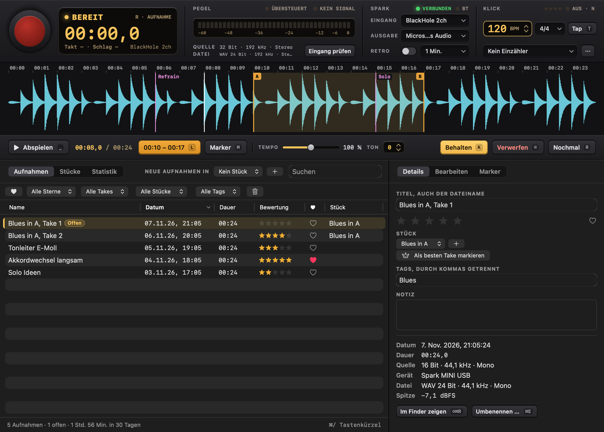
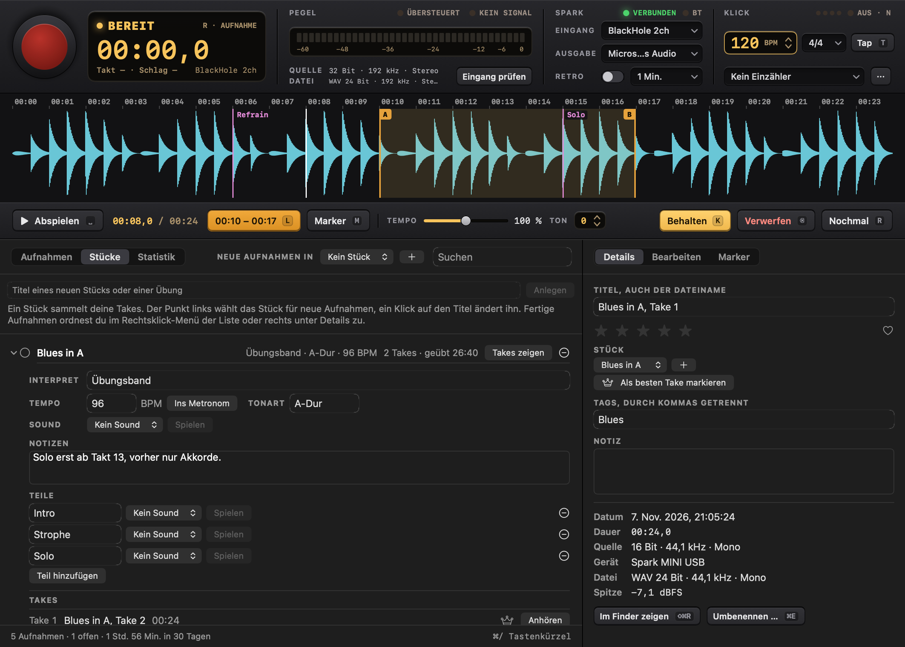
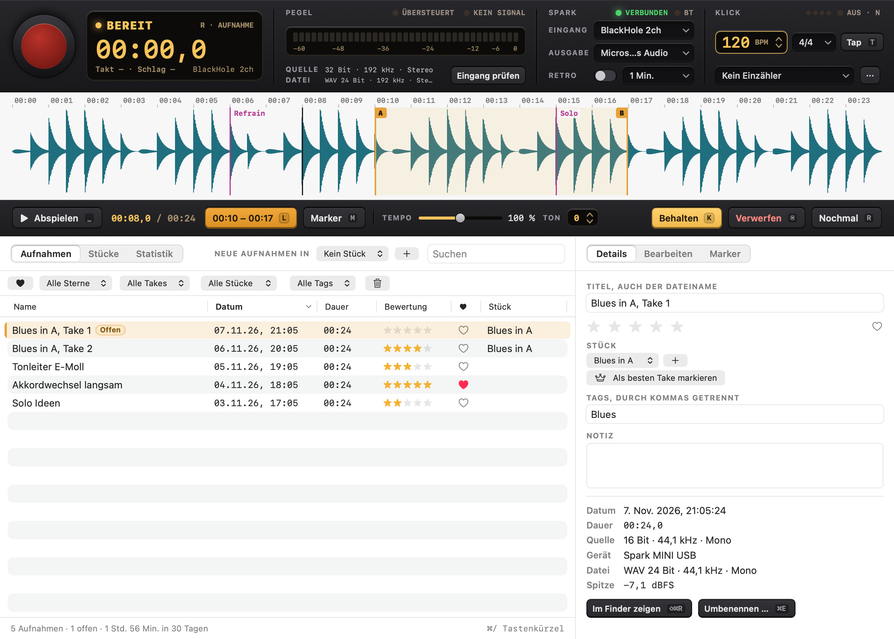
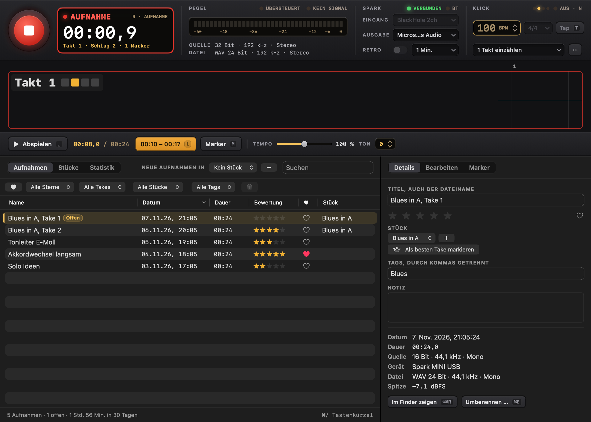
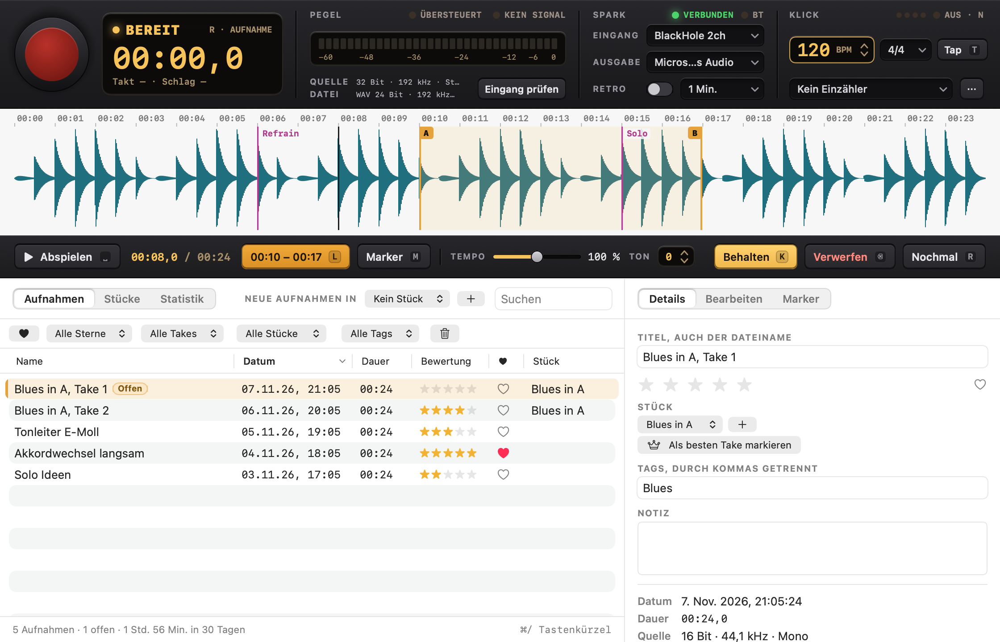

# Spark Studio

A native macOS practice studio for the Positive Grid Spark MINI, in one window: record, listen right away, decide and keep
practicing, in a few seconds and without the mouse; shape the amp's sounds in a preset editor; and keep with every take
the sound it was played with.

It only records from a USB device with "Spark" in its name. Without one it records nothing: no microphone, no other input
and no automatic fallback. Pulling the cable closes the input, and plugging it back in starts nothing by itself.

Everything stays on this Mac. The app makes no network connections and has no telemetry. Its only other connection is
Bluetooth LE to the amp, and only when asked for.



## Build and run

```bash
./build.sh            # builds "build/Spark Studio.app"
./build.sh --install  # also copies it to /Applications and adds it to the Dock
```

Requires macOS 14 or later and the Swift toolchain from Xcode. There are no external dependencies. The build signs with
an Apple Development certificate if one exists, because macOS then keeps the microphone permission across rebuilds.
Without one it uses an ad-hoc signature. `SPARK_SIGN_IDENTITY` overrides the choice, and `-` forces ad-hoc.

**Linux and one version everywhere.** The area Presets also exists for Linux (Omarchy), see [linux/README.md](linux/README.md).
`./sync.sh` builds and installs the Mac app and the Linux app on the Omarchy laptop and checks that both report the
same version, `Spark Studio <VERSION> (<commit>)`. `VERSION` is the one place to change it.

Spark Studio joins the former apps Spark Recorder and Spark Presets. Plan, decisions and what comes next are in
[docs/STUDIO.md](docs/STUDIO.md).

## The window

- The **deck** stays on top: the record key with the display, the level, the Spark module (USB input, output, retro,
  and the lamp "BT" for the amp's Bluetooth) and the click.
- Below it the toolbar's tabs, or `⇧⌘1` and `⇧⌘2`, choose the **area**: **Aufnahme** (waveform, transport, library,
  pieces, statistics) or **Presets** (the amp's slots, the presets on the Mac and the editor).
- A running recording continues when the window closes. The Dock icon then shows REC and brings the window back.
- **Bluetooth on demand**: Studio does not look for the amp when it starts. It connects when the area Presets first
  shows, with the key "Verbinden" at the foot of the presets' sidebar, with a click on the lamp "BT", or with
  "Verstärker → Mit dem Verstärker verbinden". "Trennen" lets the Spark app on the phone take the amp again, because
  the amp takes only one control connection.

## Keyboard

Single keys act only in the area Aufnahme, `R` and `Space` in both. None of them acts while you type in a text field,
and only `⌫` removes anything, only to the Trash, undoably. `⌘/` shows every shortcut.

| Key | Where | Action |
|---|---|---|
| `R` | both | Start or stop recording, also "Nochmal" |
| `Space` | both | Play or pause. During a recording it stops it and plays the new take right away, during the count-in it cancels |
| `⇧⌘1` / `⇧⌘2` | both | Area Aufnahme / Presets |
| `⌘Z` / `⇧⌘Z` | both | Undo / redo, in the area in front |
| `⌘S` | both | Save the preset in the editor on the Mac |
| `⌘1` – `⌘4` | both | Play slot 1 to 4 on the amp, while connected |
| `⌘E` / `⌘⌫` / `⇧⌘R` | both | Rename / to the Trash / show in Finder: the take in Aufnahme, the preset in Presets |
| `⌘F` | Aufnahme | Search the recordings |
| `L` | Aufnahme | Loop: first press sets A, second sets B, third removes it |
| `M` | Aufnahme | Marker, also during a recording |
| `K` | Aufnahme | Keep the take |
| `⌫` | Aufnahme | Discard the selected takes: they go to the Trash, the next take is in focus, and `⌘Z` brings them back. Not while recording |
| `←` `→` | Aufnahme | Jump 5 seconds, with `⇧` 1 second |
| `-` `+` / `0` | Aufnahme | Slower or faster / reset tempo and pitch |
| `1` – `5` / `F` | Aufnahme | Rate / favorite |
| `B` | Aufnahme | Switch take while comparing |
| `N` / `T` | Aufnahme | Click on or off, heard only while playing or recording / tap tempo |
| `G` | Aufnahme | Save the retro buffer ("Das eben war gut") |
| `Esc` | Aufnahme | Leave a text field |
| `⌘N` / `⇧⌘N` / `⌘D` | Presets | New preset / from a template / duplicate |
| `⇧⌘S` | Presets | Save under a new name |
| `⌥⌘1` – `⌥⌘4` | Presets | Store in slot 1 to 4 (asks first, backs up the slot, reads it back) |
| `⌘B` / `⇧⌘L` / `⌘R` | Presets | Compare with the saved state / live changes on or off / read the amp again |
| `⌃1` – `⌃7` / `⌃0` | Presets | Choose a unit of the chain / switch it on or off |
| arrows | Presets | Turn the focused knob, `⇧` for big steps |

The list is `Sources/SparkCore/StudioKeymap.swift`, and its tests make sure that no key does two things in one area.

## Where things are

```
~/Music/Spark Studio/
  Aufnahmen/
    *.wav                  Recordings. They are the originals and are never rewritten.
    Bibliothek.json        Metadata: names, ratings, tags, notes, takes, markers, edits, pieces. Plain, readable JSON.
    Bibliothek.backup.json The previous version of that file.
    Exporte/               Default folder for exports. It is not part of the library.
    .wellenformen/         Waveform cache. Safe to delete, it is rebuilt when needed.
    .presets/<take id>.json The sound each take was recorded with, as a preset file.
    .aufnahme-laeuft.json  Exists only during a recording, for crash recovery.
  Presets/
    *.json                 Presets on the Mac, one readable JSON file each, the backups of overwritten slots,
                           and sound recipes written by hand or by an AI assistant (see Sound recipes).
```

**At the first start** Spark Studio takes over the folders of the former apps, `~/Music/Spark Recorder` and
`~/Music/Spark Presets`, by copying them. On APFS the copy is instant and takes no space until a file changes. The old
folders stay exactly as they were and are never deleted. If Spark Recorder still runs, Studio says so and waits until
the next start, so no recording can be split between two folders. Studio also takes over the former apps' settings,
such as input and click. A library from before Spark Studio keeps a copy of its file as
`Bibliothek.vor-Schema-2.aus-1.json` before it is first saved in the new format, which older versions only open
read-only.

Files placed in the recordings folder are picked up on the next start or with "Ordner prüfen". Files renamed in the
Finder keep their metadata. A missing file keeps its entry and is marked. Older recordings are adopted unchanged, with no
gain and with an unknown source, because what happened to them before is not known. Presets placed in the presets folder
show up when the window comes to the front.

## Every take knows its sound

When a recording starts while the amp is connected, the take keeps what the amp plays: the preset in the editor when it
plays live, a tried-out preset, or the stored slot. It is read from memory, never asked of the amp, so nothing can delay
a recording, and a failing Bluetooth connection cannot end one. The inspector shows "Sound: Crunch, Platz 2". "Auf den
Amp" plays it on the amp's temporary place, never in a slot, and "Im Editor öffnen" opens it as a new preset to save.
Takes recorded with the same sound share its fingerprint, the SHA-256 of the effect chain.

**One tempo.** Opening a preset sets the click to its tempo. Changing the click by hand asks whether the preset should
get the new tempo too, with a key in the message; nothing is written into a preset without that.

## Pieces and songs

A piece is a song or an exercise. It collects its takes and its practice time, which counts discarded takes too, and it
knows what it takes to play it: artist, tempo ("Ins Metronom" sets the click to it), key, notes, a sound, and parts such
as intro, verse and solo, each with its own sound. "Spielen" plays a sound on the amp's temporary place. The dot in front
of a piece chooses it for new recordings.



## Recording safety

- The input runs on its own AUHAL unit. The realtime code is in C (`Sources/CSparkRT`) and does not lock, allocate or
  block. Playback, analysis and the UI have no way to stall it.
- Audio is written continuously. If the app crashes, the next start repairs the file's header and adds the take, with
  its markers and its sound. Repair only changes size fields in the header, and the audio bytes stay as they were. A
  file that cannot be repaired stays where it is and gets reported.
- A lost device or a sample rate changed by another app ends the recording safely and keeps what was recorded. If the
  input just stops delivering, the app warns but keeps the file open, in case the device returns.
- Recordings stop safely when the disk is nearly full and just below the 4 GB limit of the WAV format.
- Only one app at a time uses the recordings library. Started a second time, Studio leaves it alone and says so.

## Feedback and the click

Whether the amp's USB input also carries its USB output is not assumed. While recording, playback and click are blocked
on outputs of the same hardware as the input. The click picks a safe output on its own. "Aufnahme → Rückkopplung messen"
plays quiet clicks and checks whether they arrive at the input. Only a measurement can unlock a pair of devices, and it
counts for exactly that pair.

The click has no code path into the recording, so the app cannot write it to a file.

While playing, the click is mixed into what plays and goes to the playback output. It follows the take's bars, or the
metronome's tempo from the start of a take without bars, and it never reaches a file or an export. While recording, it
runs on its own unit on the click output. A count-in always sounds, even with the click switched off.

## Bars

A recording with a count-in or with the click switched on knows its bars. The window shows the current bar and beat
while recording, and the waveform shows bar lines, also afterwards. Tempo and meter stay fixed during a recording, because
the bars rest on them.

Dragging over the waveform of such a take selects whole bars, and `⌥` selects freely. The bar controls below the transport
loop the chosen bars or record them again. Recording bars again counts in at the tempo and meter of the take, stops by
itself shortly after the last bar and creates a recording of its own, such as "Take Takt 5-8.wav". It keeps the bar
numbers and the piece of the take. The original stays as it is, and the two are not merged.

## Timing of click and bars

The bars are meant to be as exact as in a DAW, well under a millisecond on the app's side:

- The click runs on the input's clock. Its beats lie on input frames, and every output block is placed by its host
  time stamp, so click and input never drift apart, even on two devices with separate clocks and for any length of
  take. The file and the count-in gate are counted in the same input frames, so bar 1 lies exactly where it should.
- The latencies the devices report are added: output latency of the click device and input latency of the amp,
  each as device plus stream latency. The safety offset is already part of Core Audio's time stamps and is not added.
- What the amp does inside, in its converters and effects, no device reports. "Aufnahme → Klick-Latenz messen" plays
  clicks through a cable from the click output into the amp's guitar input, the way a played note travels, and
  measures where they land in a temporary file. It refuses a result when the clicks are missing or spread more than
  2 ms. The result counts for exactly that pair of devices and for recordings made afterwards. It can also be set by
  hand in the metronome details, in steps of 0.5 ms.

### Measuring the latency

The Mac's headphone output is a 3.5 mm jack and the amp's guitar input is 6.3 mm, so the cable needs both ends: a
3.5 mm stereo to 6.3 mm mono cable, or a 3.5 mm cable with a 3.5 mm to 6.3 mm adapter. The click plays on both
channels, so the left one is enough.

1. Unplug the guitar and connect the cable from the headphone output to the amp's guitar input. Keep USB connected.
2. On the amp, choose a preset without delay, reverb and noise gate, and turn the master volume down.
3. Set the Mac's volume to about half.
4. In the metronome details, the click output must be the headphone output ("Externe Kopfhörer"). "Eingang prüfen"
   and retro recording must be off.
5. Choose "Aufnahme → Klick-Latenz messen …" and "Messen". It takes about ten seconds.
6. Unplug the cable and plug the guitar back in.

Without a cable, a wired headphone or earbud held directly on a pickup works too. The pickup picks up the speaker's
magnetic field without any delay of its own, so the click then takes exactly the way a played note does. Mute the
strings, turn the Mac up and use a preset with some gain. The neck pickup and single coils give the strongest signal.

The result is stored for the input and the click output it was measured with. The internal delay of the amp is most of
it, so for another click output, such as the built-in speakers, the same correction can be set by hand.

On the BlackHole loop test, every beat lands within one sample of the grid.

## Audio quality

- The device runs at its highest rate up to 192 kHz during a recording, and its previous rate comes back afterwards.
- Files are always WAV with 24 bits. A 16-bit source stays lossless and gains headroom for editing, but no extra detail.
  The window therefore shows source and file separately, and nothing is labeled "Hi-Res".
- On the tested amp, the USB descriptor offers one channel at 16 bits and 44.1 kHz for capture. Higher quality from the
  amp needs a different signal path, such as its line out into an audio interface.

## Edits

Trim, fades, gain and automatic level are stored in the library and applied when listening and exporting. Automatic
level raises the peak to -1 dBFS with one constant gain of at most 30 dB. Dynamics stay intact and the noise floor rises
with it. Only an export writes a new file, and it refuses to replace the original.

## Retro recording

Off by default. While on, the input stays open and the display says "HÖRT MIT". The last minutes are held in memory only
and never reach the disk on their own. "Das eben war gut" saves them. Turning it off, losing the device, closing the
window or quitting erases the buffer.

## The area Presets


- **Click to hear**: clicking a slot in the sidebar, or `⌘1` – `⌘4`, switches the amp to it and opens it in the
  editor, like the preset button on the amp. A speaker marks what plays. Clicking a preset on the Mac plays it on
  the amp's temporary place, which never touches a slot, and a new preset plays at once. Clicking quickly through
  the list sends only the last one. When the amp's own preset button is pressed, the app follows, unless the editor
  holds unsaved changes.
- **Load meter**: a row of amber segments in the display fills while a preset travels to or from the amp, chunk by
  chunk as the amp confirms or sends them ("LÄDT 9/17"). A switch between slots, a single message, shows a short
  sweep. With "Reduce motion" the sweep is left out.
- **Editor**: the signal chain as a row of pedals with the amp head in the middle. A click on a unit shows all its
  controls below: the model, chosen from the catalog, on and off, and every parameter as a knob, a switch or a
  selector. Knobs turn by dragging (`⌥` for fine steps), with the scroll wheel or the arrow keys (`⇧` for big steps),
  a double click goes back to the model's start value, and VoiceOver can adjust them. `⌃1` – `⌃7` choose a unit,
  `⌃0` switches it.
- **Live**: the first change sends the preset to the amp's temporary place, without touching a slot, and every change
  after it is heard at once. Only the newest value of a knob is sent, one message at a time, and model changes are
  spaced out, because a fast series of them once made the amp hang. After a lost connection the edited state goes
  back to the amp. `⇧⌘L` turns live changes off.
- **Undo, A/B, changed**: `⌘Z` and `⇧⌘Z` undo and redo, a whole knob turn being one step. `⌘B` plays the saved state
  for comparing and back. The display says when something differs from the saved state, and switching to another
  preset asks first.
- **Saving**: `⌘S` saves on the Mac, into the preset's own file or as a new one, `⇧⌘S` under a new name. "Auf Platz N
  speichern" (`⌥⌘1` – `⌥⌘4`) asks first, then reads the slot fresh from the amp and saves it on the Mac as a backup,
  stores the preset, switches to it and reads it back to check it arrived unchanged. If the connection breaks while
  storing, the app checks the slot as soon as the amp is back and says what it holds.
- **New presets** (`⌘N`, `⇧⌘N`, `⌘D`): empty, from five templates or as a copy, with name (at most 31 bytes),
  description and BPM.
- **Auf dem Mac**: presets as files, searchable by name and model. Rename with `⌘E`, `⌘⌫` moves the file to the
  Trash and the banner brings it back.

The app only scans for devices that offer the Spark control service, so it never sees other Bluetooth devices. The
Spark app on the phone must be disconnected, because the amp takes only one control connection. For the same reason
Spark Studio and `spark-probe` cannot talk to the amp at the same time: whichever starts second keeps searching.

## Amp control over Bluetooth

The amp's sounds are controlled over Bluetooth LE, not over USB: its USB side offers only audio and volume keys.
`spark-probe` is a test tool for that control channel, and the area Presets is built on the same protocol in
`Sources/SparkControl`.

```bash
swift build --product spark-probe
.build/debug/spark-probe scan          # look for the amp
.build/debug/spark-probe info          # firmware, name, current preset number, the playing and the 4 stored presets
.build/debug/spark-probe preset 2      # switch to stored preset 2, like the preset button
.build/debug/spark-probe watch 30      # print what the amp sends, e.g. when its preset button is pressed
.build/debug/spark-probe try 3         # play a renamed copy of stored preset 3 without storing it
.build/debug/spark-probe store-test 4 backup.json        # store a renamed copy in slot 4, then put the original back
.build/debug/spark-probe persist-test store 4 backup.json  # leave a renamed copy in slot 4 …
.build/debug/spark-probe persist-test check 4 backup.json  # … and after switching the amp off and on, check it
.build/debug/spark-probe live 4 script.txt  # play a copy of slot 4 without storing it and run live changes on it
.build/debug/spark-probe backup folder      # write the four stored presets to JSON files
.build/debug/spark-probe catalog-check amp Twin 8  # try 8 amp models from "Twin" on, on the temporary preset
```

A `live` script has one command per line: `param <place> <index> <value>`, `toggle <place> on|off`,
`model <place> <model id>`, `sweep <place> <index> <from> <to> <steps> <ms>`, `wait <seconds>`, `read`, `resend`,
`say <text>` and `raw <command> <sub> <hex bytes>`. A place is 1 to 7 or a model id. After `read`, the probe compares
what the amp plays with what the script sent. The comments in `Sources/SparkProbe/LiveScript.swift` have the details.

`--raw` also prints every byte, `--no-header` sends without the block header, `--no-input` leaves the input byte out
of live changes. The Spark app on the phone and Spark Studio must be disconnected, because the amp takes only one
control connection. macOS asks once for Bluetooth access for the terminal app. The tool shows only devices with
"Spark" in their name and only counts the others.

### What is checked on the amp

Positive Grid does not document the protocol. This follows community reverse engineering (see [Sources](#sources)),
and every line below was checked with `spark-probe` on a Spark MINI with firmware 1.11.2.75.

| Message | What it does | On the Spark MINI |
|---|---|---|
| Service `FFC0`, write `FFC1`, notify `FFC2` | Control channel | Confirmed |
| Block header `01 FE 00 00 53 FE <len> 00…`, chunks `F0 01 <seq> <xor> <cmd> <sub> <7-bit data> F7` | Framing | Confirmed |
| `02 2F`, `02 11`, `02 10`, `02 01` | Read firmware, name, preset number, a preset (`00 <slot>`, or `01 00` for the playing one) | Confirmed |
| `01 01` | Send a preset in chunks of 25 bytes, one Bluetooth write each. `05 01` per chunk, `04 01` at the end | Confirmed |
| `01 38` | Switch preset, `7F` is the temporary one. Ack `04 38` | Confirmed |
| `01 04` | Set a parameter: `len A0+len <model id>`, index, `CA` float, input byte `00`. No ack | Confirmed and heard, with and without the input byte |
| `01 15` | Effect on or off: model id, `C2`/`C3`, `00`. Ack `04 15` | Confirmed by reading back |
| `01 06` | Change a model: old id, new id, `00`. Ack `04 06` | Confirmed by reading back. The amp loads its own start values for the new model |
| `03 38` | The amp's preset button | Confirmed |
| `03 37`, `03 15` | The amp reports parameter changes and on/off | Seen only as echoes of the probe's own changes, see below. The MINI's guitar and music volume knobs report nothing |
| `03 71` | Sent by the amp now and then, probably power and battery | Seen, not decoded |
| `03 64`, `03 65` | Probably tuner reading and tuner on/off | Seen, not checked |

More findings:

- **Stored presets survive switching the amp off.** A copy stored in slot 4 was still there after switching off and on.
- **The temporary preset ends with the connection.** After the control connection closes, the amp plays the stored
  preset that was selected last. A stored slot that was selected stays selected.
- **The preset's end holds a checksum.** After the effects come, on stored slots, two floats (loudness, 9990 meaning
  not set, and extra gain, 0.5) and a byte that is the sum of all bytes after the two place bytes, modulo 256. The
  playing preset has only the checksum. Every one of the 5 presets read matched this rule. `SparkPreset.encode`
  recomputes the byte, so an edited preset stays consistent, and a preset read from the amp still encodes back to
  exactly the same bytes. An earlier version sent renamed copies with a stale checksum, and the amp played them anyway.
- **The amp keeps two parameters in step with on and off itself:** parameter 2 of the noise gate and parameter 7 of
  the reverb. It also adds reverb parameter 7 when a stored preset without it is played on `7F`.
- **Speed:** 30 parameter changes in a row without any pause arrived. The last value is what plays.
- **Echoes:** In one session, after a fast series of changes, the amp started to answer every parameter change with
  `03 37` and an on/off change with `03 15` instead of `04 15`. A second request for the same change then got no
  answer at all. This did not happen again in a fresh session with the same steps, so its cause is unknown. Both
  forms count as a confirmation, and an answer that stays out is checked by reading the playing preset back.
- The amp sometimes ignores a request, so every request is sent a second time when no answer comes.
- **Too many model changes in a row made the amp hang.** About 40 model changes within two minutes, with no pause
  between them, first brought the echoes above and then silence. The amp no longer reacted to its power button,
  while its Bluetooth still took connections. Unplugging USB, holding POWER for more than 10 seconds and switching it
  on again brought it back, with all four stored presets unchanged. In batches of 8 with a second between changes and
  a new connection per batch, the remaining 34 changes went through without a single echo. `catalog-check` therefore
  works in such batches and stops at the first echo, and the editor spaces out model changes.

### Model catalog

`Sources/SparkControl/Catalog` describes every amp and effect model: its place in the chain, a name and a short
description written for this project, the device it is modeled after as a neutral hint, and what each parameter is
(knob, switch, selector with its values). Names and descriptions are this project's own, not those of the official
app. A model id the catalog does not know still works, with numbered knobs, and so do parameters beyond the ones the
catalog names.

`spark-probe catalog-check` checked the catalog on the Spark MINI: it chose every model on the temporary preset and
read back what the amp played. All 68 freely available models were accepted: 1 noise gate, 5 compressors, 10 drives,
33 amps, 12 modulation effects, 6 delays and the reverb with 9 types. `Models+Defaults.swift` holds the values the
amp chose for each, which the editor uses as start values, and their number is the number of parameters the amp
gives the model. Three models have more parameters than the community sources name (vibrato 3, mini vibe 4, square
tremolo 4), and they appear numbered. The models of the paid Jimi Hendrix add-on are in the catalog but hidden, and
the five that were tried were refused, because the add-on is not unlocked on this amp.

The order of reverb parameters 2 to 5 is disputed between sources. The catalog follows the two that agree (low cut,
high cut, density, length), and a listening test confirmed it: with everything else at its maximum, parameter 3 at 0
made the reverb dull but still long, parameter 5 at 0 made it short.

### Sound recipes and AI assistants

A **sound recipe** describes a sound by what it is: a model and settings for each place of the chain, knobs from 0 to
10, in a small JSON file. Claude or any other AI assistant can write one, and Spark Studio reads it from the presets
folder like a preset, marked with a wand. [docs/ai/SOUND-GUIDE.md](docs/ai/SOUND-GUIDE.md) explains the format and how
to choose models and values. [docs/ai/spark-catalog.json](docs/ai/spark-catalog.json) lists every model with its
parameter keys and start values. In this repository the project skill `spark-sound` lets Claude Code build sounds on
request.

```bash
swift run SparkStudio --recipe-check docs/ai/examples/texas-blues.json    # can Studio read it, and with which values
swift run SparkStudio --recipe-from "$HOME/Music/Spark Studio/Presets/Jazz.json"  # a saved preset as a recipe
swift run SparkStudio --recipe-prompt docs/ai/examples/texas-blues.json   # the sound in English, e.g. for REACTOR
swift run SparkStudio --catalog-export docs/ai                            # write the catalog files again
```

Positive Grid's REACTOR amp is not compatible with Spark and documents no preset format. Its "Text to Tone" takes the
description from `--recipe-prompt`; the guide's section Devices has the details.

A test fails when `docs/ai` falls behind the catalog, so a new model goes into `Sources/SparkControl/Catalog` and then
through `--catalog-export`.

### Sources

Only the facts of the protocol were taken from these projects, no code. Byte layouts were rewritten and then checked
on the amp.

- Paul Hamshere: [Spark](https://github.com/paulhamsh/Spark), SparkIO, Spark-Parser (Apache-2.0), and
  [Spark-Bluetooth-Message-Format](https://github.com/paulhamsh/Spark-Bluetooth-Message-Format) (no license, read only)
- [Ignitron](https://github.com/stangreg/Ignitron) (BSD-3-Clause)
- [SparkBox](https://github.com/paulhamsh/SparkBox) and kindling-control-spark-amps (GPL-3.0, read only)
- soundshed-app and spark-web (MIT)
- For the catalog also [PGSparkLite](https://github.com/richtamblyn/PGSparkLite) (Apache-2.0) and SparklingTones
  (MIT). Positive Grid's own pages were not copied.

## Design (Gestaltung)

One design language: the instrument stays dark, keys instead of buttons and lamps instead of icons. The desk around it
would follow the system, but Spark Studio always shows it dark; the light pictures below show the light desk that tests
can still draw. [docs/DESIGN.md](docs/DESIGN.md) has the principles, every value and the building blocks of
`Sources/SparkDesign`. New views use those blocks; a new color or button style goes into SparkDesign and DESIGN.md
first. The icon (`Tools/make-icon.swift`) puts the record key into the amber ring of a control: recording and sound
in one sign.

| | |
| --- | --- |
|  |  |
|  |  |
|  |  |

The pictures come from the app's own snapshot modes, with a test library of synthetic takes and made-up presets:

```bash
.build/debug/SparkStudio --library /tmp/studio-pictures --ui-selftest pictures /tmp/studio-pictures-out
.build/debug/SparkStudio --library /tmp/studio-presets --offline --appearance dark --size 1180x780 \
    --open saved:Lead --focus delay --snapshot /tmp/presets-dark.png --quit
```

The `pictures` scenario also shows the count-in, a running recording (from the test device only), a piece with its
parts and the smallest window, 1120 × 720 ([Presets at that size](docs/pictures/presets-smallest-dark.png)). `swift
test` checks the contrast of every text color of the design against its backgrounds, at least 4.5 : 1.

## Project layout

```
Sources/CSparkRT        Realtime capture and click (C)
Sources/SparkCore       Capture, library, repair, edits, playback, export, statistics, Studio's folders and keymap
                        (no UI)
Sources/SparkDesign     The design: colors, keys, lamps, displays, knobs, pedals (SwiftUI, no app code)
Sources/SparkControl    The amp's Bluetooth control protocol, the model catalog and the preset library, without
                        Bluetooth code
Sources/SparkRecorderUI The deck and the area Aufnahme: window parts, menus, keys, self-test, headless audio commands
Sources/SparkPresetsUI  The area Presets: sidebar, editor, menus and the Bluetooth link (CoreBluetooth)
Sources/SparkStudio     The app: one window, the areas, and what ties takes, sounds and tempo together
Sources/SparkProbe      spark-probe, the experimental Bluetooth test tool
Tests/SparkCoreTests    Unit tests and audio tests with synthetic signals
Tests/SparkControlTests Protocol and library tests with made-up presets
Tests/SparkDesignTests  Contrast of every text color against its backgrounds
Tools/make-icon.swift   Draws the app icon
```

A new area joins as a library with a host, like `RecorderHost` and `PresetsHost`, and a case in `StudioArea`
(`Sources/SparkStudio/Studio.swift`); docs/STUDIO.md lists the steps.

## Tests

```bash
swift test
```

All audio is generated by the tests. No test reads a real recording. The audio path tests send a tone through the
virtual [BlackHole](https://github.com/ExistentialAudio/BlackHole) device, and they skip with a reason when BlackHole or
the microphone permission is missing. Since 2026-11-08 four of them fail on this Mac because the tone does not come
back through BlackHole; docs/STUDIO.md has the details.

The recipe tests also check the files in `docs/ai`: every example must be a valid recipe, and the catalog files must
match the catalog in the code. After a change to `Sources/SparkControl/Catalog`, run
`swift run SparkStudio --catalog-export docs/ai`.

The audio engine refuses every input outside its policy. The default is Spark only, and tests use a policy that allows
virtual test devices and nothing real, not even the amp.

The app also has self-tests that drive its real window. They only run with a separate test library, which keeps them
away from your recordings and presets and skips taking over the old folders. A test library only hears BlackHole, sound
goes to a silent virtual output, and the presets live in its subfolder `Presets`, filled with made-up presets:

```bash
"build/Spark Studio.app/Contents/MacOS/SparkStudio" --library /tmp/studio-test --ui-selftest main /tmp/studio-results
```

Other scenarios are `legacy`, `crash-start`, `crash-verify`, `realwindow`, `pictures` and `sound` (a take keeps a
made-up sound, and an amp action that fails during the recording must not end it). Two more cover the Spark-only rule
and take an extra option: `nospark` with `--test-input none`, and `reconnect` with `--test-input aggregate`.
`--menu-dump <file>` lists every menu item with its key and state, once with each area in front, and checks with a real
key press that a Presets key reaches Presets only while that area shows. `--live-selftest <log>` edits a copy of slot 1
on the amp's temporary place and reads back after every step (needs the amp). On the Spark MINI all ten checks passed
in Spark Presets, which ran the same code; in Studio it has not been run yet.

These headless commands check the audio path without the UI:

```bash
SparkStudio --list
SparkStudio --record "Spark" 5 /tmp/test.wav
SparkStudio --play-tone "BlackHole" 5 1000 0.25
SparkStudio --inspect /tmp/test.wav
```
