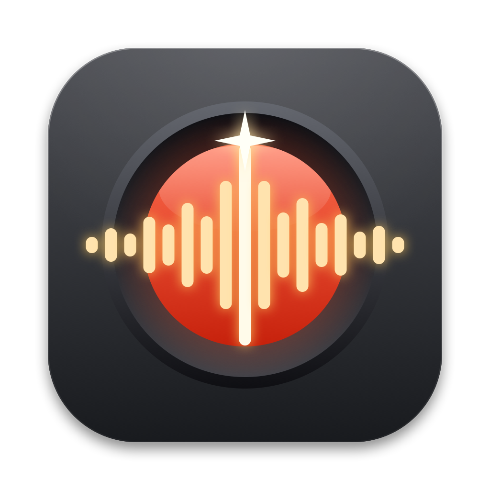
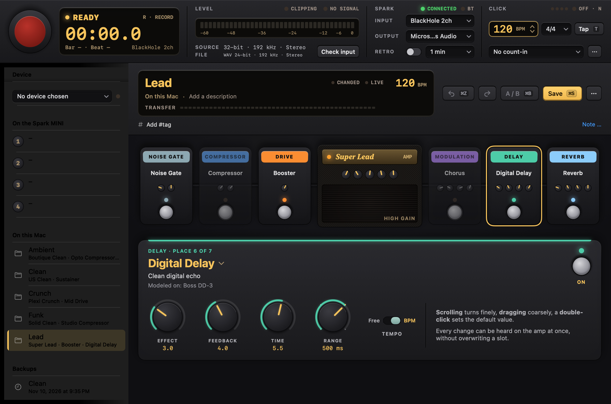
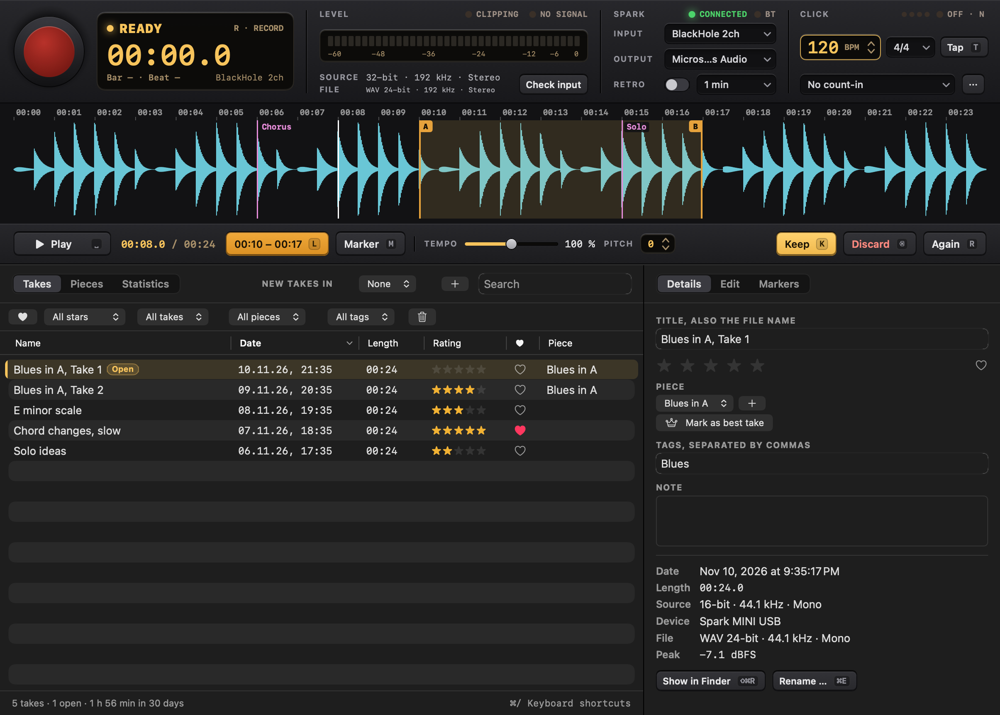
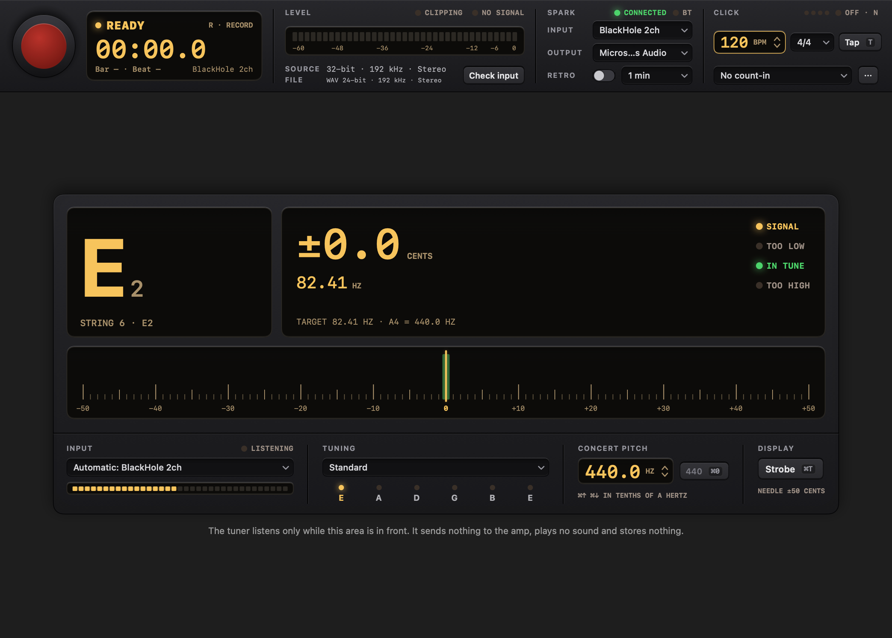
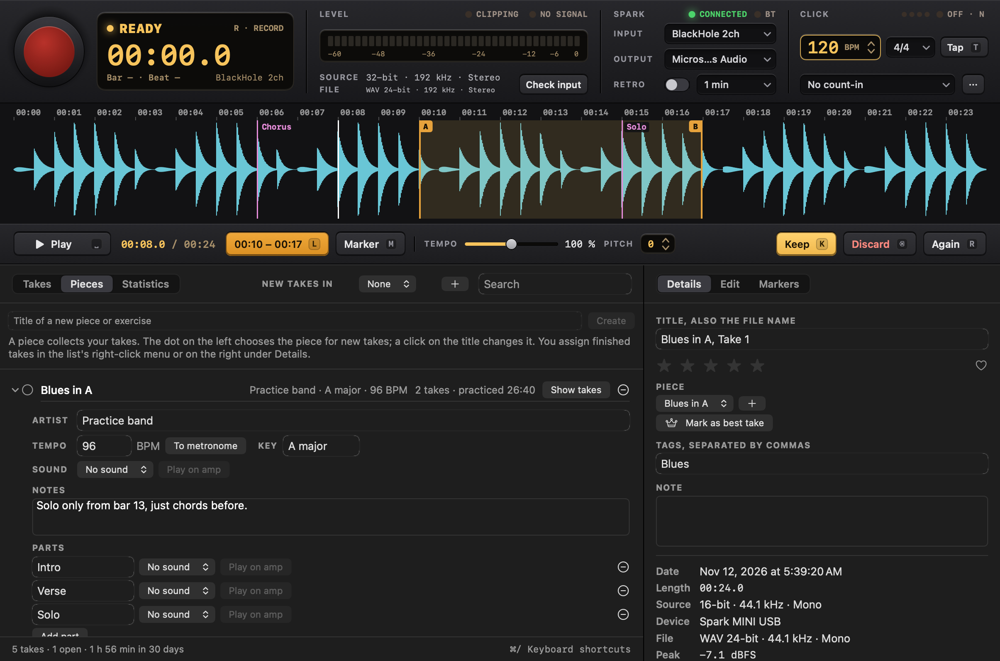
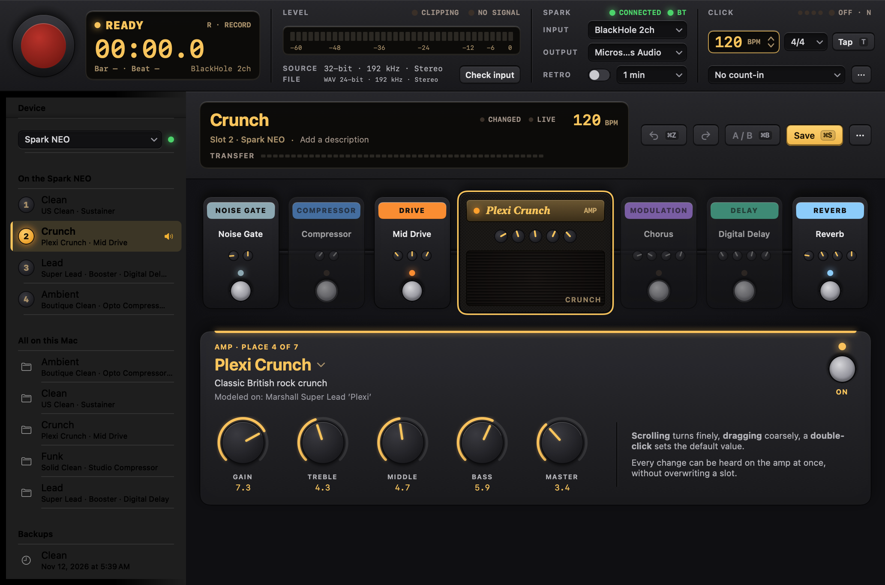

<div align="center">



# AmpBench

**A practice studio for Positive Grid guitar amps — record, shape sounds, tune. One window, no mouse needed.**


[](LICENSE)

[What it does](#what-it-does) · [Devices](#supported-devices) · [Install](#build-and-install) ·
[First steps](#first-steps) · [Privacy](#privacy) · [Docs](#documentation)



</div>

Record a take, listen right away, decide and keep practicing, in a few seconds and without the mouse; shape the
amp's sounds in a preset editor over Bluetooth; tune; and keep with every take the sound it was played with. Native
on macOS (SwiftUI) and on Linux (Qt), with Presets and Tuner on the iPad from the Mac's code, and an encrypted
store that keeps your sounds in a place of your choice.

| Record | Tuner |
| --- | --- |
|  |  |
| **Pieces** | **Devices** |
|  |  |

<sub>All pictures come from the app's own snapshot mode, with a simulated amp and made-up takes and presets.</sub>

> [!IMPORTANT]
> **Not an official product.** AmpBench is an independent project. It is not affiliated with, endorsed by or
> supported by Positive Grid or Kemper. Spark, Spark MINI, Spark NEO and REACTOR are trademarks of Positive Grid, and
> Kemper Profiler is a trademark of Kemper GmbH; the names are used only to say which devices the app works with. The
> amp's Bluetooth protocol is not documented by its maker, so everything here rests on observation. Use it on your
> device at your own risk, keep the volume low when you try something new, and see [LICENSE](LICENSE) (MIT) for the
> terms.

## What it does

**Record**
- One key (`R`) starts and stops a take; `Space` plays it at once; keep it, discard it or go again.
- Records only from a USB device with "Spark" in its name: no microphone, no other input, no automatic fallback.
- Click, count-in and bars, timed well under a millisecond on the app's side; loop bars or record them again.
- Keyboard first: single keys for loop, marker, rating, tempo and compare; `⌘/` shows every shortcut.
- Crash-safe: audio is written continuously and repaired on the next start. Originals are never rewritten; trim,
  fades and gain are stored beside them and applied when listening and exporting.
- Retro recording keeps the last minutes in memory, for the take you did not plan.
- Pieces (songs and exercises) collect takes, practice time, tempo, key and a sound for every part.
- Every take remembers the preset the amp played, and can put it back on the amp.

**Presets**
- Reads the amp's slots over Bluetooth LE; a click plays a slot or a preset from the computer.
- An editor with the signal chain as pedals and an amp head; every change is heard live on the amp.
- Undo, A/B against the saved state, and storing in a slot with a backup and a read-back.
- Presets are plain JSON files, ordered with hashtags and pinned tags.

**Sound store** (Mac, iPad and Linux)
- Keeps every sound encrypted in a place you choose: a folder (also one iCloud Drive, Google Drive or Dropbox keeps
  in step), your own server over SSH, or an HTTPS address such as a WebDAV folder.
- Encrypted on the device with the [age](https://age-encryption.org) format; the place sees only unreadable files.
  The key lives in the system keychain (on Linux in the desktop's keyring), not in the presets folder or a setting.
- A second device with the same key gets the same sounds, and changes travel both ways. Nothing is ever deleted in
  the store. See [docs/STORE.md](docs/STORE.md).
- A catalog of 68 amp and effect models, each checked on the amp.

**Tuner**
- Guitar and bass, 30 Hz to 1.4 kHz, read to a tenth of a cent, needle or strobe.
- Tunings Standard, Drop D, DADGAD, Open G, half a step down, chromatic; concert pitch 430.0 to 450.0 Hz.
- Listens along with the recorder's input, or switches on the amp's own tuner over Bluetooth.

**AI Sound**
- Describe a sound in your own words and get three suggestions, played on the amp to try.
- "warmer", "more gain", "less reverb" and "brighter" adjust a suggestion.
- Sound recipes are small JSON files that any AI assistant can write; see
  [docs/ai/SOUND-GUIDE.md](docs/ai/SOUND-GUIDE.md).

**Import from Kemper**
- Reads a Kemper Profiler backup (`.kpabackup`) or rig (`.kipr`) and turns performances into Spark presets and
  pieces. A profile captures a real amp and the Spark models one, so every imported sound wants a listen.
- Read-only: nothing is ever sent to the Kemper.

## Supported devices

| Device | What AmpBench does | Checked |
|---|---|---|
| Spark MINI | everything above | firmware 1.11.2.75 |
| Spark NEO | everything above; it does not record over USB (its headphones show no audio device) | firmware 1.16.1.60 |
| REACTOR 50 | reads its eight presets after connecting and shows them like a Spark's slots (name, amp, effects); a click on a slot switches the amp to it and opens it in the editor: amp knobs, effects on/off and effect knobs are heard live where the model's name is known, and "Store" writes the preset back in the REACTOR's own format and reads it back; shows what is turned and pressed on the amp, stamps takes with it. "Play on the REACTOR" sets amp, gain, tone and effects of a Spark preset with single live commands. Models cannot be exchanged yet; wah, equalizer and FX loop stay as stored; never a Spark preset | presets read and seen, live commands heard by the owner, 2026-11-10; slot switch, store and read back checked with the probe on the amp, 2026-11-11; editing from the app not yet tried on the amp |
| REACTOR 100 | listens only, sends nothing | not checked |
| any other Spark | reads and switches slots, nothing more, until checked | – |

The amp takes only one control connection, so the Spark app on the phone must be disconnected. Details per device
are in the [manual](docs/MANUAL.md#devices) and in [docs/STUDIO.md](docs/STUDIO.md#devices).

## Privacy

Everything stays on your computer, and the app has no telemetry. Its only connections are Bluetooth LE to the amp
and — only when you ask for an AI Sound — one request to Ollama's cloud API that carries your description of the
sound; both happen only when asked for. The key for that API is kept in the system keychain, never in a file.
The sound store is off until you set it up. It then sends your sounds only to the place you chose, encrypted before
they leave the device, with a key that stays in the keychain.
Found a security problem? See [SECURITY.md](SECURITY.md).

## Languages

English by default, German when the system language is German. The menu "Language" switches between them; on Linux
the same.

## Build and install

**macOS** (14 or later, with the Swift toolchain from Xcode; no other dependencies):

```bash
./build.sh            # builds "build/AmpBench.app"
./build.sh --install  # also copies it to /Applications and adds it to the Dock
```

**Linux** (Python 3, PipeWire and BlueZ; installs for the current user, without root):

```bash
linux/install.sh "$(git rev-parse --short HEAD)"   # runs the tests, then installs into ~/.local
ampbench                                           # the window
ampbench --demo                                    # a simulated amp and a temporary folder, to look around
```

**iPad** (iPadOS 17 or later; needs Xcode and XcodeGen):

```bash
./ios/build.sh --simulator   # builds and starts it in an iPad simulator
./ios/build.sh --device      # builds signed and installs it on a connected iPad
```

The iPad app has the areas Presets and Tuner and the sound store; Record is not there yet. More in
[ios/README.md](ios/README.md).

The Linux app has the areas Record, Presets and Tuner, the Kemper import, hashtags and AI Sound; only the REACTOR's
presets, their editing and storing, and live commands are Mac-only so far. `./sync.sh` keeps a Mac and a Linux laptop on the same version,
whichever of the two you develop on. More in [linux/README.md](linux/README.md) and [docs/DEVELOPMENT.md](docs/DEVELOPMENT.md).

## First steps

1. Connect the Spark over USB and start AmpBench. The deck on top shows the input and its level.
2. Press `R` to record and `R` again to stop; `Space` plays the take, `K` keeps it, `⌫` moves it to the Trash.
3. Switch to Presets with `⇧⌘2`. AmpBench connects to the amp over Bluetooth (disconnect the Spark app on the
   phone first) and reads its slots; click one to hear it and open it in the editor.
4. Turn a knob: the change is heard at once, on the amp's temporary place. Nothing is stored in a slot until you
   ask for it, and the slot is backed up first.
5. `⇧⌘3` opens the tuner. `⌘/` lists every shortcut.

On Linux the same keys work with Ctrl in place of `⌘`.

## Where your data lives

```
~/Music/AmpBench/
  Recordings/  Recordings (*.wav, the originals) and the library file Library.json, plain readable JSON
  Presets/     Presets, backups of overwritten slots and sound recipes, one readable JSON file each
```

Folders and files from versions before 1.0 with German names (`Aufnahmen`, `Bibliothek.json`) are renamed once at the
first start; nothing is copied or deleted. The AI Sound key is kept in the macOS Keychain, on Linux in the desktop's keyring. On the
iPad the presets are in the app's Documents folder ("On My iPad → AmpBench" in Files). The sound store's key is in the
keychain and its place in the app's preferences (on Linux: the desktop's keyring and `~/.config/ampbench/`, see
[docs/STORE.md](docs/STORE.md#on-linux)); neither is a file in this folder or in the repository. The full
list of files is in the [manual](docs/MANUAL.md#where-things-are).

## Documentation

| | |
|---|---|
| [docs/MANUAL.md](docs/MANUAL.md) | The window, every keyboard shortcut, recording, bars and click timing, pieces, edits, retro recording, the Presets area, devices, the tuner, AI Sound |
| [docs/PROTOCOL.md](docs/PROTOCOL.md) | Amp control over Bluetooth: the confirmed messages, findings on the amp, the model catalog, the test tool `spark-probe` |
| [docs/DEVELOPMENT.md](docs/DEVELOPMENT.md) | Building and signing, project layout, tests and self-tests, command-line modes, how the pictures are made |
| [docs/STUDIO.md](docs/STUDIO.md) | Plan, decisions, device findings (Spark NEO, REACTOR 50), protecting the amp, open points |
| [docs/DESIGN.md](docs/DESIGN.md) | The design language: principles, values, building blocks |
| [docs/ai/SOUND-GUIDE.md](docs/ai/SOUND-GUIDE.md) | Sound recipes for AI assistants, with the [model catalog](docs/ai/spark-catalog.md) |
| [docs/STORE.md](docs/STORE.md) | The sound store: what is encrypted how, what the place sees, syncing, reading it without the app, a place of your own |
| [linux/README.md](linux/README.md) | The Linux app |
| [ios/README.md](ios/README.md) | The iPad app: what it has, building, the simulator, UI tests |

## Sources and credits

Only the facts of the protocol were taken from these projects, no code. Byte layouts were rewritten and then checked
on the amp.

- Paul Hamshere: [Spark](https://github.com/paulhamsh/Spark), SparkIO, Spark-Parser (Apache-2.0), and
  [Spark-Bluetooth-Message-Format](https://github.com/paulhamsh/Spark-Bluetooth-Message-Format) (no license, read only)
- [Ignitron](https://github.com/stangreg/Ignitron) (BSD-3-Clause)
- [SparkBox](https://github.com/paulhamsh/SparkBox) and kindling-control-spark-amps (GPL-3.0, read only)
- soundshed-app and spark-web (MIT)
- For the catalog also [PGSparkLite](https://github.com/richtamblyn/PGSparkLite) (Apache-2.0) and SparklingTones
  (MIT). Positive Grid's own pages were not copied.

## License

MIT, see [LICENSE](LICENSE).
