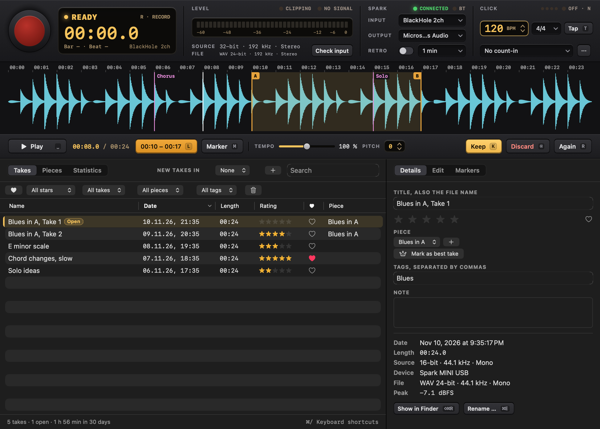
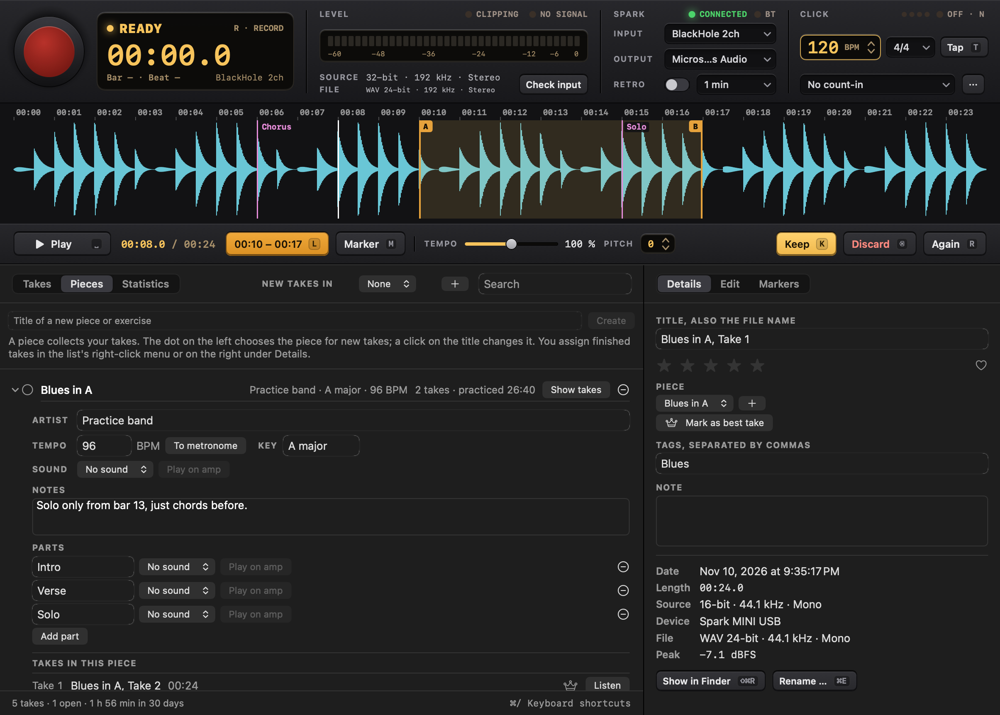
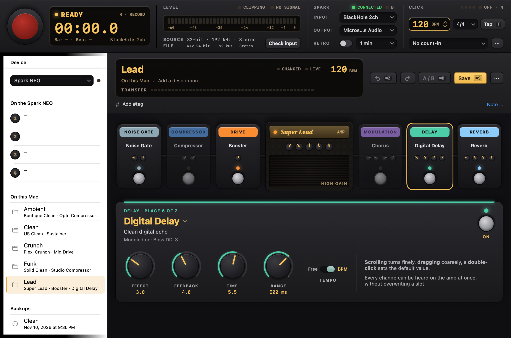
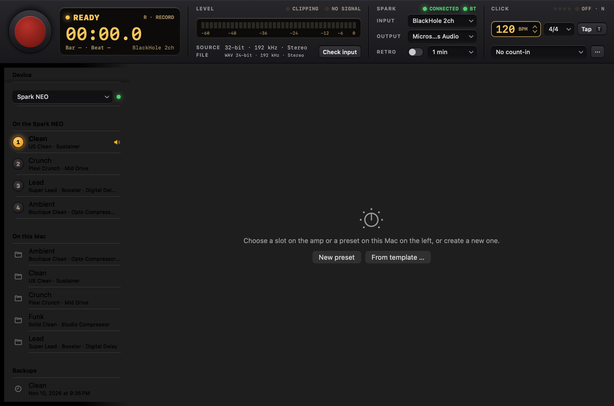
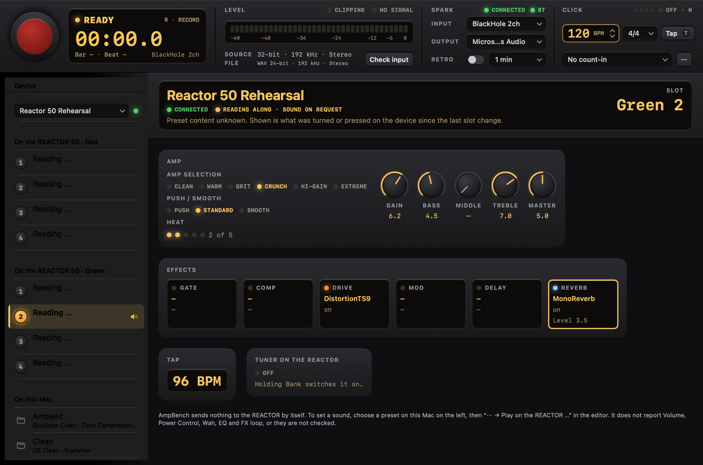
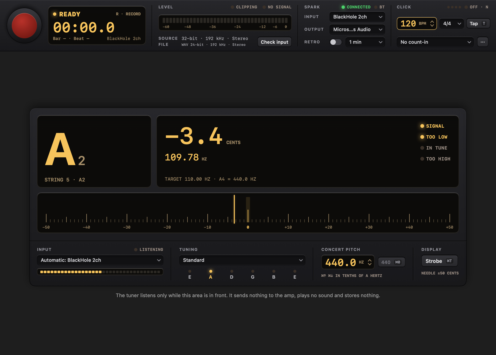

# AmpBench manual

How to use the app: the window, the keyboard, recording, pieces, edits, the Presets area, the devices, the tuner and
AI Sound. The Mac app is described here; the [Linux app](../linux/README.md) has the same areas. For the Bluetooth
protocol see [PROTOCOL.md](PROTOCOL.md), for building and testing [DEVELOPMENT.md](DEVELOPMENT.md), for decisions
and device findings [STUDIO.md](STUDIO.md).

The UI is English by default and German when the system language is German; the menu "Language" switches it. This
manual quotes the English labels.

- [The window](#the-window)
- [Keyboard](#keyboard)
- [Where things are](#where-things-are)
- [Recording](#recording): [sound of a take](#every-take-knows-its-sound), [pieces](#pieces-and-songs),
  [safety](#recording-safety), [click](#feedback-and-the-click), [bars](#bars), [timing](#timing-of-click-and-bars),
  [audio quality](#audio-quality), [edits](#edits), [retro recording](#retro-recording)
- [The area Presets](#the-area-presets), [Devices](#devices), [AI Sound](#ai-sound)
- [The area Tuner](#the-area-tuner)

## The window

AmpBench only records from a USB device with "Spark" in its name. Without one it records nothing: no microphone, no
other input and no automatic fallback. Pulling the cable closes the input, and plugging it back in starts nothing by
itself.

- The **deck** stays on top: the record key with the display, the level, the Spark module (USB input, output, retro,
  and the lamp "BT" for the amp's Bluetooth) and the click.
- Below it the toolbar's tabs, or `⇧⌘1`, `⇧⌘2` and `⇧⌘3`, choose the **area**: **Record** (waveform, transport,
  library, pieces, statistics), **Presets** (the amp's slots, the presets on the Mac and the editor) or
  **Tuner**.
- A running recording continues when the window closes. The Dock icon then shows REC and brings the window back.
- **Bluetooth on demand**: AmpBench does not look for the amp when it starts. It connects when the area Presets first
  shows, with the key "Connect" at the foot of the presets' sidebar, with a click on the lamp "BT", or with
  "Amp → Connect to the amp". "Disconnect" lets the Spark app on the phone take the amp again, because
  the amp takes only one control connection.
- **Several devices**: Spark MINI, Spark NEO and REACTOR 50 (see [Devices](#devices)). The first section of the
  presets' sidebar, **Device**, chooses one; its lamp is green when connected, amber when nearby and dark when not
  there.

## Keyboard

Single keys act only in the area Record, `R` and `Space` in every area. None of them acts while you type in a text
field, and only `⌫` removes anything, only to the Trash, undoably. `⌘/` shows every shortcut.

| Key | Where | Action |
|---|---|---|
| `R` | all | Start or stop recording, also "Again" |
| `Space` | all | Play or pause. During a recording it stops it and plays the new take right away, during the count-in it cancels |
| `⇧⌘1` / `⇧⌘2` / `⇧⌘3` | all | Area Record / Presets / Tuner |
| `⌘Z` / `⇧⌘Z` | all | Undo / redo, in the area in front |
| `⌘S` | all | Save the preset in the editor on the Mac |
| `⌘1` – `⌘4` | all | Play slot 1 to 4 on the amp, while connected |
| `⌘E` / `⌘⌫` / `⇧⌘R` | all | Rename / to the Trash / show in Finder: the take in Record, the preset in Presets |
| `⌘F` | Record | Search the recordings |
| `L` | Record | Loop: first press sets A, second sets B, third removes it |
| `M` | Record | Marker, also during a recording |
| `K` | Record | Keep the take |
| `⌫` | Record | Discard the selected takes: they go to the Trash, the next take is in focus, and `⌘Z` brings them back. Not while recording |
| `←` `→` | Record | Jump 5 seconds, with `⇧` 1 second |
| `-` `+` / `0` | Record | Slower or faster / reset tempo and pitch |
| `1` – `5` / `F` | Record | Rate / favorite |
| `B` | Record | Switch take while comparing |
| `N` / `T` | Record | Click on or off, heard only while playing or recording / tap tempo |
| `G` | Record | Save the retro buffer ("That was good") |
| `Esc` | Record | Leave a text field |
| `⌘N` / `⇧⌘N` / `⌘D` | Presets | New preset / from a template / duplicate |
| `⇧⌘S` | Presets | Save under a new name |
| `⌥⌘1` – `⌥⌘4` | Presets | Save to slot 1 to 4 (asks first, backs up the slot, reads it back) |
| `⌘B` / `⇧⌘L` / `⌘R` | Presets | Compare with the saved state / live changes on or off / read the amp again |
| `⌃1` – `⌃7` / `⌃0` | Presets | Choose a unit of the chain / switch it on or off |
| arrows | Presets | Turn the focused knob, `⇧` for big steps |
| `⌘T` | Tuner | Needle or strobe |
| `⌘↑` / `⌘↓` / `⌘0` | Tuner | Concert pitch A4 0.1 Hz up / down / back to 440 Hz |
| `⌃1` – `⌃6` | Tuner | Tuning: Standard, Drop D, DADGAD, Open G, half a step down, chromatic |

On a device with more slots, `⌘1` – `⌘8` and `⌥⌘1` – `⌥⌘8` reach all of them. The list is
`Sources/SparkCore/StudioKeymap.swift`, and its tests make sure that no key does two things in one area.

## Where things are

Folder and file names on disk are the same in both languages; some of them are German in this release.

```
~/Music/AmpBench/
  Aufnahmen/               The recordings folder.
    *.wav                  Recordings. They are the originals and are never rewritten.
    Bibliothek.json        Metadata: names, ratings, tags, notes, takes, markers, edits, pieces. Plain, readable JSON.
    Bibliothek.backup.json The previous version of that file.
    Exporte/               Default folder for exports. It is not part of the library.
    .wellenformen/         Waveform cache. Safe to delete, it is rebuilt when needed.
    .presets/<take id>.json The sound each take was recorded with, as a preset file.
    .aufnahme-laeuft.json  Exists only during a recording, for crash recovery.
  Presets/
    *.json                 Presets on the Mac, one readable JSON file each, the backups of overwritten slots,
                           and sound recipes written by hand or by an AI assistant (see AI Sound).
```

**At the first start** AmpBench takes over the folders of the former apps, `~/Music/Spark Recorder` and
`~/Music/Spark Presets`, by copying them. On APFS the copy is instant and takes no space until a file changes. The old
folders stay exactly as they were and are never deleted. If Spark Recorder still runs, AmpBench says so and waits
until the next start, so no recording can be split between two folders. AmpBench also takes over the former apps'
settings, such as input and click. A library from before AmpBench keeps a copy of its file as
`Bibliothek.vor-Schema-2.aus-1.json` before it is first saved in the new format, which older versions only open
read-only.

Files placed in the recordings folder are picked up on the next start or with "Check folder". Files renamed in the
Finder keep their metadata. A missing file keeps its entry and is marked. Older recordings are adopted unchanged, with
no gain and with an unknown source, because what happened to them before is not known. Presets placed in the presets
folder show up when the window comes to the front.

## Recording



### Every take knows its sound

When a recording starts while the amp is connected, the take keeps what the amp plays: the preset in the editor when
it plays live, a tried-out preset, or the stored slot. It is read from memory, never asked of the amp, so nothing can
delay a recording, and a failing Bluetooth connection cannot end one. The inspector shows "Sound: Crunch, slot 2".
"To the amp" plays it on the amp's temporary place, never in a slot, and "Open in editor" opens it as a new preset to
save. Takes recorded with the same sound share its fingerprint, the SHA-256 of the effect chain.

**One tempo.** Opening a preset sets the click to its tempo. Changing the click by hand asks whether the preset should
get the new tempo too, with a key in the message; nothing is written into a preset without that.

### Pieces and songs

A piece is a song or an exercise. It collects its takes and its practice time, which counts discarded takes too, and
it knows what it takes to play it: artist, tempo ("To metronome" sets the click to it), key, notes, a sound, and
parts such as intro, verse and solo, each with its own sound. "Play" plays a sound on the amp's temporary place. The
dot in front of a piece chooses it for new recordings.



### Recording safety

- The input runs on its own AUHAL unit. The realtime code is in C (`Sources/CSparkRT`) and does not lock, allocate or
  block. Playback, analysis and the UI have no way to stall it.
- Audio is written continuously. If the app crashes, the next start repairs the file's header and adds the take, with
  its markers and its sound. Repair only changes size fields in the header, and the audio bytes stay as they were. A
  file that cannot be repaired stays where it is and gets reported.
- A lost device or a sample rate changed by another app ends the recording safely and keeps what was recorded. If the
  input just stops delivering, the app warns but keeps the file open, in case the device returns.
- Recordings stop safely when the disk is nearly full and just below the 4 GB limit of the WAV format.
- Only one app at a time uses the recordings library. Started a second time, AmpBench leaves it alone and says so.

### Feedback and the click

Whether the amp's USB input also carries its USB output is not assumed. While recording, playback and click are
blocked on outputs of the same hardware as the input. The click picks a safe output on its own. "Record → Measure
feedback" plays quiet clicks and checks whether they arrive at the input. Only a measurement can unlock a pair of
devices, and it counts for exactly that pair.

The click has no code path into the recording, so the app cannot write it to a file.

While playing, the click is mixed into what plays and goes to the playback output. It follows the take's bars, or the
metronome's tempo from the start of a take without bars, and it never reaches a file or an export. While recording, it
runs on its own unit on the click output. A count-in always sounds, even with the click switched off.

### Bars

A recording with a count-in or with the click switched on knows its bars. The window shows the current bar and beat
while recording, and the waveform shows bar lines, also afterwards. Tempo and meter stay fixed during a recording,
because the bars rest on them.

Dragging over the waveform of such a take selects whole bars, and `⌥` selects freely. The bar controls below the
transport loop the chosen bars or record them again. Recording bars again counts in at the tempo and meter of the
take, stops by itself shortly after the last bar and creates a recording of its own, a file named after the take and
its bars (for example bars 5-8). It keeps the bar numbers and the piece of the take. The original stays as it is, and
the two are not merged.

### Timing of click and bars

The bars are meant to be as exact as in a DAW, well under a millisecond on the app's side:

- The click runs on the input's clock. Its beats lie on input frames, and every output block is placed by its host
  time stamp, so click and input never drift apart, even on two devices with separate clocks and for any length of
  take. The file and the count-in gate are counted in the same input frames, so bar 1 lies exactly where it should.
- The latencies the devices report are added: output latency of the click device and input latency of the amp,
  each as device plus stream latency. The safety offset is already part of Core Audio's time stamps and is not added.
- What the amp does inside, in its converters and effects, no device reports. "Record → Measure click latency" plays
  clicks through a cable from the click output into the amp's guitar input, the way a played note travels, and
  measures where they land in a temporary file. It refuses a result when the clicks are missing or spread more than
  2 ms. The result counts for exactly that pair of devices and for recordings made afterwards. It can also be set by
  hand in the metronome details, in steps of 0.5 ms.

#### Measuring the latency

The Mac's headphone output is a 3.5 mm jack and the amp's guitar input is 6.3 mm, so the cable needs both ends: a
3.5 mm stereo to 6.3 mm mono cable, or a 3.5 mm cable with a 3.5 mm to 6.3 mm adapter. The click plays on both
channels, so the left one is enough.

1. Unplug the guitar and connect the cable from the headphone output to the amp's guitar input. Keep USB connected.
2. On the amp, choose a preset without delay, reverb and noise gate, and turn the master volume down.
3. Set the Mac's volume to about half.
4. In the metronome details, the click output must be the headphone output (macOS calls it "External Headphones").
   "Check input" and retro recording must be off.
5. Choose "Record → Measure click latency …" and "Measure". It takes about ten seconds.
6. Unplug the cable and plug the guitar back in.

Without a cable, a wired headphone or earbud held directly on a pickup works too. The pickup picks up the speaker's
magnetic field without any delay of its own, so the click then takes exactly the way a played note does. Mute the
strings, turn the Mac up and use a preset with some gain. The neck pickup and single coils give the strongest signal.

The result is stored for the input and the click output it was measured with. The internal delay of the amp is most of
it, so for another click output, such as the built-in speakers, the same correction can be set by hand.

On the BlackHole loop test, every beat lands within one sample of the grid.

### Audio quality

- The device runs at its highest rate up to 192 kHz during a recording, and its previous rate comes back afterwards.
- Files are always WAV with 24 bits. A 16-bit source stays lossless and gains headroom for editing, but no extra
  detail. The window therefore shows source and file separately, and nothing is labeled "Hi-Res".
- On the tested amp, the USB descriptor offers one channel at 16 bits and 44.1 kHz for capture. Higher quality from
  the amp needs a different signal path, such as its line out into an audio interface.

### Edits

Trim, fades, gain and automatic level are stored in the library and applied when listening and exporting. Automatic
level raises the peak to -1 dBFS with one constant gain of at most 30 dB. Dynamics stay intact and the noise floor
rises with it. Only an export writes a new file, and it refuses to replace the original.

### Retro recording

Off by default. While on, the input stays open and the display says "LISTENING". The last minutes are held in memory
only and never reach the disk on their own. "That was good" saves them. Turning it off, losing the device, closing the
window or quitting erases the buffer.

## The area Presets



- **Click to hear**: clicking a slot in the sidebar, or `⌘1` – `⌘4` (up to `⌘8` on a device with more slots),
  switches the amp to it and opens it in the editor, like the preset button on the amp. A speaker marks what plays.
  Clicking a preset on the Mac plays it on the amp's temporary place, which never touches a slot, and a new preset
  plays at once. Clicking quickly through the list sends only the last one. When the amp's own preset button (or the
  NEO's middle button) is pressed, the app follows, unless the editor holds unsaved changes.
- **Load meter**: a row of amber segments in the display fills while a preset travels to or from the amp, chunk by
  chunk as the amp confirms or sends them ("LOADING 9/17"). A switch between slots, a single message, shows a short
  sweep. With "Reduce motion" the sweep is left out.
- **Editor**: the signal chain as a row of pedals with the amp head in the middle. A click on a unit shows all its
  controls below: the model, chosen from the catalog, on and off, and every parameter as a knob, a switch or a
  selector. Knobs turn by dragging (`⌥` for fine steps), with the scroll wheel or the arrow keys (`⇧` for big steps),
  a double click goes back to the model's start value, and VoiceOver can adjust them. `⌃1` – `⌃7` choose a unit,
  `⌃0` switches it.
- **Live**: the first change sends the preset to the amp's temporary place, without touching a slot, and every change
  after it is heard at once. Only the newest value of a knob is sent, one message at a time, and model changes are
  spaced out, because a fast series of them once made the amp hang. After a lost connection the edited state goes
  back to the amp. `⇧⌘L` turns live changes off.
- **Undo, A/B, changed**: `⌘Z` and `⇧⌘Z` undo and redo, a whole knob turn being one step. `⌘B` plays the saved state
  for comparing and back. The display says when something differs from the saved state, and switching to another
  preset asks first.
- **Saving**: `⌘S` saves on the Mac, into the preset's own file or as a new one, `⇧⌘S` under a new name. "Store in
  slot N" (`⌥⌘1` – `⌥⌘4`) asks first, then reads the slot fresh from the amp and saves it on the Mac as a backup,
  stores the preset, switches to it and reads it back to check it arrived unchanged. If the connection breaks while
  storing, the app checks the slot as soon as the amp is back and says what it holds.
- **New presets** (`⌘N`, `⇧⌘N`, `⌘D`): empty, from five templates or as a copy, with name (at most 31 bytes),
  description and BPM.
- **On this Mac**: presets as files, searchable by name, model, tags and notes ("#clean" searches tags only). Rename
  with `⌘E`, `⌘⌫` moves the file to the Trash and the banner brings it back.
- **Hashtags**: every preset can carry tags such as `#basis`, `#unterricht`, `#song`, `#u2`, edited in the line below
  the editor's name (typed with or without "#", several separated by blanks) or from the sidebar's context menu
  "Tags", next to the preset's notes. The sidebar's section Tags filters by a click (several tags: all must match)
  and pins a tag with a right click; every pinned tag becomes a section of its own, and a preset may stand in several.
- **Import from Kemper** (File menu, "+" in the sidebar): reads a Kemper Profiler backup (`.kpabackup` from a USB
  stick) or a rig (`.kipr`). For every performance you choose song, basic setup, lesson or skip; the window shows
  which Spark amp each slot becomes and which Kemper effects the Spark has no match for. Songs become pieces with one
  part per slot, each with its preset; equal sounds become one preset with the tags of all their uses. The import
  writes the tags `song`, `basis` (basic setup) and `unterricht` (lesson); these stored names are German in this
  release. A profile captures a real amp and the Spark models one, so every imported sound wants a listen. Nothing is
  ever sent to the Kemper. `--kemper-list <file>` shows the same on the command line.
- **Copy text for REACTOR** (editor, "⋯"): the sound as English text for "Text to Tone" in the REACTOR app, the
  same as `--recipe-prompt`. The REACTOR reads the text itself and picks its own models.

### Devices



| Device | What AmpBench does | Checked |
|---|---|---|
| Spark MINI | everything above | firmware 1.11.2.75 |
| Spark NEO | everything above; it does not record over USB (its headphones show no audio device) | firmware 1.16.1.60 |
| REACTOR 50 | reads its eight presets after connecting and shows them like a Spark's slots (name, amp, effects); shows what is turned and pressed on the amp, stamps takes with it. "Play on the REACTOR" sets amp, gain, tone and effects with single live commands. No preset is written or stored | presets read and seen, live commands heard by the owner, 2026-11-10 |
| REACTOR 100 | listens only, sends nothing | not checked |
| any other Spark | reads and switches slots, nothing more, until checked | – |

- **One connection at a time.** Choosing another device ends the current one first. The Spark NEO drops a sound
  that plays without being stored when the connection ends and plays its stored slot again, so AmpBench asks first:
  "The sound on the NEO is lost when you disconnect. Save it as a preset first?" The Spark MINI is treated the same
  until checked. If the connection ends anyway, a banner says so, and a running take keeps the sound it started with.
- **Play on the REACTOR** (editor, "⋯", with a REACTOR 50 connected and a preset from the Mac open): AmpBench
  works out the nearest of the REACTOR's six amps (Clean to Extreme) from the preset's amp model, and after a
  question sets bass, middle, treble and gain, then the amp, then switches the effects it knows by name (gate,
  compressor, drive, modulation, delay, reverb) and the reverb's level, one message at a time. The master is never
  touched; turn the volume down first, another amp can be louder. The REACTOR keeps presets in a format of its own
  that AmpBench does not write, so the sound holds until the slot changes and is stored only on the device, which
  overwrites that slot. A slot with other effects than the factory ones ignores their switches.
- **REACTOR**: after connecting, AmpBench reads the REACTOR 50's eight stored presets and the playing slot, and shows
  them in the sidebar like a Spark's slots: the preset's name, and its amp and effects below. Reading is all it does
  by itself; the presets are in the REACTOR's own format, which AmpBench reads and cannot write yet. The area Presets
  shows the slots in two banks (Red, Green) and a panel: amp, Push/Smooth, Heat, Gain to Master, the effects,
  the tapped tempo and its tuner. After a slot change it says "Preset content unknown", because the REACTOR does
  not send the preset. A take recorded with it keeps those readings as "read only", without a fingerprint.



The app only scans for devices that offer the Spark control service (FFC0) or REACTOR's (FFD0), so it never sees
other Bluetooth devices. A REACTOR's Bluetooth name ends in a part its owner chose; the window shows it, logs never
do. The Spark app on the phone must be disconnected, because the amp takes only one control connection. For the same
reason AmpBench and `spark-probe` cannot talk to the amp at the same time: whichever starts second keeps searching.

### AI Sound

A **sound recipe** describes a sound by what it is: a model and settings for each place of the chain, knobs from 0 to
10, in a small JSON file. Claude or any other AI assistant can write one, and AmpBench reads it from the presets
folder like a preset, marked with a wand. [ai/SOUND-GUIDE.md](ai/SOUND-GUIDE.md) explains the format and how
to choose models and values. [ai/spark-catalog.json](ai/spark-catalog.json) lists every model with its
parameter keys and start values.

In the Presets area, **AI Sound** turns a description in your own words — “Blues for my Tele”, “a sound like U2 …” —
into such a recipe right in the app, over Ollama's cloud API, and plays it on the amp to try. You get three different
suggestions, each shown as soon as it is ready; “warmer”, “more gain”, “less reverb” and “brighter” adjust one of them
with a follow-up request, and a request can be cancelled. Only the description leaves the Mac (a description with an
e-mail address, phone number or key in it is refused), and the last wishes are kept on this Mac to pick again. It
needs an Ollama API key (ollama.com/settings/keys), entered in the AI Sound dialog and stored in the macOS Keychain
(on Linux in the desktop's keyring, see the [Linux app](../linux/README.md)).
In this repository the project skill `spark-sound` lets Claude Code build sounds on request.

Positive Grid's REACTOR amp is not compatible with Spark and documents no preset format. Its "Text to Tone" takes the
description from `--recipe-prompt`; the guide's section Devices has the details. The command-line modes for recipes
are listed in [DEVELOPMENT.md](DEVELOPMENT.md#command-line-modes).

## The area Tuner



A tuner for guitar and bass, 30 Hz to 1.4 kHz, read to a tenth of a cent. Play a string: the note shows large with
its octave and string ("STRING 6 · E2"), the deviation in cents with one decimal, the frequency in Hz with two, and
the lamps SIGNAL, TOO LOW, IN TUNE (green, within ±0.5 cents for 0.4 s) and TOO HIGH. Below it a needle field from
−50 to +50 cents, or with `⌘T` a strobe that stands still when the string is in tune. The concert pitch is set from
430.0 to 450.0 Hz in tenths; tuning, pitch and display are remembered.

- **Input:** the Spark chosen in the deck, read along with the recorder's own input, so a running recording or the
  retro buffer is never touched. Another input, such as an interface or the Mac's microphone, can be chosen in the
  module INPUT. The lamp says "SHARED" while a recording uses the same input.
- **The amp's own tuner:** INPUT starts on "Automatic": the Spark's USB input when the connected amp has USB
  audio and is plugged in (MINI), otherwise the amp's own tuner (NEO, or a MINI over Bluetooth only). It can also be
  chosen as "Tuner of the Spark NEO" (or MINI). AmpBench switches the amp's built-in tuner on over Bluetooth while the
  area shows, and off when you leave it, disconnect or quit. The amp is silent meanwhile, as when you use its tuner by
  hand. Its readings are coarser: whole cents, smoothed over 0.4 s, within about ±3 cents for IN TUNE. The amp names
  only the note, so for E in standard tuning (sixth and first string) the octave and Hz stay empty. This is how the
  NEO, which has no USB audio, can be tuned in AmpBench. Shown before the area Presets, the tuner starts the Bluetooth
  link itself (once; never after "Disconnect").
- **Only while it shows:** the tuner listens only while its area is in front and the window can be seen. Leaving it
  closes the input again, unless the recorder keeps it open anyway.
- **Never a sound:** apart from the amp's own tuner you chose, it sends nothing over Bluetooth, and it plays no
  reference tone. Audio is analyzed in memory only; nothing is stored, sent or logged.

How it measures, and what the tests prove, is in [STUDIO.md](STUDIO.md#tuner).
