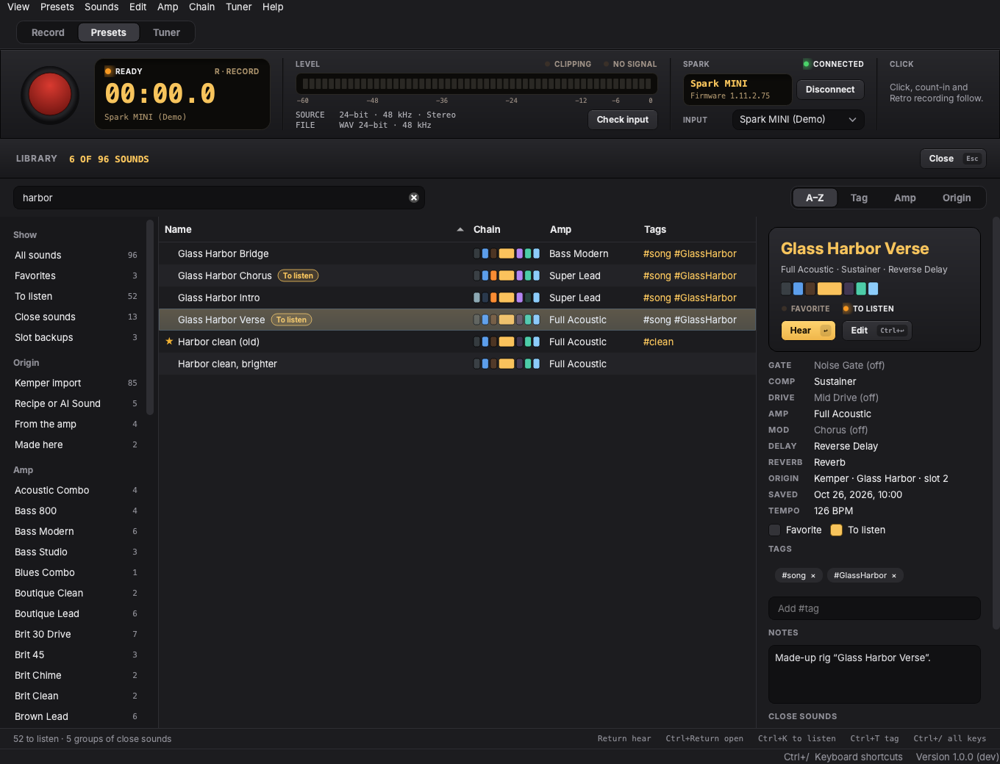

# AmpBench for Linux

AmpBench for Omarchy and other Linux desktops, with the same areas as on the Mac: **Record** (recording from
the Spark's USB input through PipeWire, the library of takes, pieces), **Presets** (read the amp's slots over
Bluetooth LE, edit a preset with knobs and the signal chain, hear every change live on the amp, keep presets on the
computer and store them in a slot, with a backup and a read-back; sound recipes open like presets) and
**Tuner**. Since 2026-11-10 it has every function the Mac app has for a Spark; only the REACTOR's presets and
live commands are not here yet. The sound library came on 2026-11-15, the same as on the Mac; the click while
recording, the bars, the click latency measurement and the timing review on 2026-11-25, without the Mac's bar tools.

The UI is English by default and German when the system language is German; the menu "Language" switches it, as on
the Mac. This page quotes the English labels.

It uses the same files as the Mac app: presets in `~/Music/AmpBench/Presets` (one JSON file each, the same format), sound
recipes, and the model catalog `docs/ai/spark-catalog.json`, which the Mac app writes from its Swift catalog. So both
apps know the same amps, effects and start values.

**Hashtags and the Kemper import** work as on the Mac: every preset can carry tags (Preset ⇒ "Edit tags …",
Ctrl+T, the context menu, or the library), pinned tags have a line of their own in the sidebar, and
Preset ⇒ "Import from Kemper …" reads a Kemper backup (`.kpabackup`) or rig (`.kipr`) into presets and pieces; every
new sound is marked "To listen" (the tag `#listen`), because it is an approximation.
`kemper.py` is the port of `Sources/SparkControl/Kemper`; on the same backup both apps print the same
`--kemper-list`.

**The sound library** works as on the Mac ([MANUAL.md](../docs/MANUAL.md#the-library)): Ctrl+L, Ctrl+F or
the line "Search 92 sounds" at the foot of the sidebar opens it over the sidebar and the editor, Esc closes it. The
search has the keyboard at once (↓ goes to the list, Return plays the first sound found); on the left the filters
(Show, Origin, Amp, Tags; a click picks one, Ctrl-click adds more), in the middle the sounds as a table (grouping
A–Z, by tag, by amp or by origin, Ctrl+G for the next; a click on a column header sorts), on the right the chosen
sound with its chain, facts, tags, notes, close sounds and the pieces that use it. Return or a double click plays it
on the amp's temporary place, Ctrl+Return opens it in the editor. With several selected (Ctrl-click, Shift-click,
Ctrl+A): tags (Ctrl+T), "To listen" (Ctrl+K), favorite (Shift+Ctrl+F), renaming by replacing a text (Ctrl+E), and
the trash (Ctrl+Backspace), which names the pieces that use them first and can be undone. The menu "Sounds" has all
of it. The sidebar is short: the slots, favorites (up to eight), the five sounds used last, and lines into the
library (all sounds, pinned tags, to listen, slot backups). Tags, origin and date step aside in a narrow window; the
preview still shows them. The grouping and the sounds used last are kept in `AmpBench.conf`, only for the real
presets folder. `library_query.py` is the port of the Mac's LibraryQuery and PresetSimilarity, `ui/library_overlay.py`
the view, `ui/library_controller.py` what it changes, `made_up.py` the made-up sounds for tests and pictures.



**The area Tuner** (Ctrl+Shift+3) works as on the Mac: a chromatic tuner with string detection for guitar and
bass, 30 Hz to 1.4 kHz, to a tenth of a cent, A4 from 430.0 to 450.0 Hz, the tunings Standard, Drop D, DADGAD, Open G,
half a step down and chromatic, needle or strobe (Ctrl+T in this area). Ctrl+↑ and Ctrl+↓ move the concert pitch by a
tenth of a hertz, Ctrl+0 sets it back to 440 Hz. It reads the Spark input along with the recorder instead of
opening it twice, and only while its area shows. The amp's own tuner as input switches a MINI's or NEO's tuner on
over Bluetooth (the amp is silent then) and off when the area is left, before a disconnect and on quit; "Automatic"
takes USB when the amp has it, otherwise the amp's own tuner. `pitch.py` and `tuning.py` port the Mac's pitch tracker
and tunings with numpy (about 7 % of one core on the laptop); `tuner.py` is the engine and model, `ui/tuner_view.py`
the front.

**The area Metronome** (Ctrl+Shift+4) works as on the Mac: one lamp per beat that lights when its click is heard
and cycles accent, normal, soft and silent on a click, 1 to 16 beats per bar, eighths, triplets or sixteenths, three
sounds, tap tempo (Ctrl+T in this area), Ctrl+↑/↓ for the tempo (with Shift in tens), the tempo trainer, and a
piece's tempo, bar and pattern loaded and kept in the recordings library (the same JSON as on the Mac). Space starts
and stops it there, Ctrl+Alt+M from every area; a recording or a playing take stops it. `metronome.py` ports the
Mac's C renderer: every pulse at `anchor + k × interval`, its click started at the fraction of a sample where it
lies. The samples go to `pw-cat` through a pipe of one page, so each write waits until PipeWire took the block before
and the device's clock paces the renderer; the lamps follow what is still in the pipe plus pw-cat's latency. Its
settings are kept under `metronome` in `~/.config/local.ampbench/AmpBench.conf`; `ui/metronome_view.py` is the front,
`--area metronome` opens it at start (for pictures).

**AI Sound** (Preset ⇒ "AI Sound from a description …", Ctrl+Alt+N) works as on the Mac: a description in your own
words goes to Ollama's cloud API, three different suggestions arrive one by one, "Listen" plays one on the amp's
temporary place, "warmer", "more gain", "less reverb" and "brighter" adjust it, "Keep" puts it into the library
as a recipe. Only the rules, the catalog, the wish and, for an adjustment, the recipe leave the computer; a wish with
an e-mail address, a phone number or a key is refused before anything is sent. The API key is kept in the desktop's
keyring through `secret-tool`, otherwise in `~/.config/ampbench/ollama-key` (mode 0600); a key stored while the
app was called Spark Studio is taken over once. The last 8 wishes are kept under `AI Sound History` in
`~/.config/local.ampbench/AmpBench.conf` and can be cleared in the window. "Cancel request" stops retries and
further rounds at once; a request already on its way runs to its end (at most 120 s) and its answer is discarded.
`sound_ai.py` is the port of SoundAI, `ai_key.py` the key store, `ui/ai_sound_dialog.py` the window.

**The sound store** works as on the Mac and shares one store with the Mac and the iPad: the presets folder is kept
encrypted (age format) in a place you choose, a folder, a server over this computer's `ssh`, or an HTTPS address,
and the sounds of your other devices arrive here. The row "Sound store" at the foot of the Presets sidebar shows
its state and opens its dialog, as do Presets ⇒ "Sound store …" and "Sync the sound store now". It syncs at the
start, when the window comes to the front (at most every five minutes) and about 15 seconds after sounds changed; a
sound removed on another device goes to the trash here. To join a store, enter its key ("Show key …" on the device
that made it). The key and an HTTPS password are kept in the desktop's keyring through `secret-tool`, otherwise in
`~/.config/ampbench/store-key` and `store-password` (mode 0600); the place is in
`~/.config/ampbench/sound-store.json`, and what was in step after the last sync in
`~/.local/state/ampbench/store-state.json`. A name with an accent is the same sound whichever way the Mac or Linux
writes the accent. `age.py` is the port of the age format (with the `cryptography` package), `store_places.py`
the places, `sound_store.py` the sync, `store_profile.py` settings and secrets, `store_cli.py` the commands,
`ui/store_view.py` the front. Format and rules: [docs/STORE.md](../docs/STORE.md).

**The click while recording** works as on the Mac (the deck's module "Click"): on or off with N (or the lamp),
tempo, time signature and Tap (T), a count-in of one or two bars, and behind "⋯" the volume and the click output
("Automatic" takes the system's output, never the amp being recorded). The settings are the metronome's (key
`metronome`). With a count-in the file starts 0.15 s before bar 1 and R during the count-in cancels it; without a
count-in and the click on, bar 1 is the click's first beat. Either way the take gets its bars (`grid`, the same JSON
as on the Mac), drawn over the waveform with bar numbers on the ruler, and a timing stamp (`timing`: click on
throughout, the click latency, wired or Bluetooth) for the timing review that follows. While a take plays with the
click on, the click plays along on its bars, at every tempo and in a loop.

The click runs on the input's clock, as on the Mac: `native/ampbench-rt.c` is one PipeWire client that records the
input (to stdout, as `pw-record` did) and plays the click, placing every beat on an input frame through the time
stamps PipeWire gives both streams (`pw_stream_get_time_n`). So the click and the Spark may run on different
devices and clocks for any length of time without drifting apart. The app speaks to it through stdin and `@` lines
on stderr; `fake_rt.py` speaks the same for the tests and `--demo`, its clicks coming back into its input like a
cable from the headphone output to the pickup. `click_timing.py` (ClickTiming, ClickLatency, the timing stamp) and
`beat_grid.py` (BeatGrid, the playback click) are ports of SparkCore.

**The timing review** works as on the Mac ([STUDIO.md](../docs/STUDIO.md#timing-review)). Behind "⋯" in the click
module, "Measure latency with a cable …" plays twelve clicks from the click output into the amp (a cable into the
guitar input, or headphones held on the pickup) and keeps the amp's part of the click latency, the delay no device
reports, with the amp; "Compensation" sets it by hand instead (it still corrects the bars, but enables no review).
Every take recorded with the click on throughout, a measured amp part and a wired click output then gets its review:
below the waveform the timing band shows the two bars around the playhead, each beat magnified to about ±60 ms, the
click lines with their beat numbers and the notes as strokes with their offset ("+18 ms"), each bar steady or
unsteady; below the transport one line gives placement, spread, accuracy and the counted notes, or why there is no
review, with the grid (quarters, eighths, triplets, sixteenths; kept with the take's piece) and "Fold". Pointing at a
bar shows its numbers, a click sends the playhead to it. `timing_review.py` is the port of TimingReview (the onset
detector, catch windows, numbers, bars, reasons), `latency_probe.py` of LatencyProbe, `timing_band.py` of TimingBand,
`ui/timing_view.py` draws band and line.

**Not here yet:** reading a REACTOR's presets, and the REACTOR live commands; "Loop bars" and "Record bars again".

## Install

On the Linux machine itself, from a checkout of this repository:

```bash
linux/install.sh "$(git rev-parse --short HEAD)"   # the argument is the build id shown by --version
```

It needs `python3` and installs without root into `~/.local/share/ampbench` (app and Python environment),
`~/.local/bin/ampbench` and the menu entry, after the tests pass. A failing test stops the install and leaves the
installed version as it is. With a C compiler (`cc`) and PipeWire's headers (`pkg-config libpipewire-0.3`; Arch
ships them with `pipewire`) it also builds `bin/ampbench-rt`, the recording and click helper; without them, or when
the helper gets nothing from the input, the app records with `pw-record` and has no click.

## Keep in step with the Mac

To keep a Mac and a Linux laptop on one version, do not install by hand. Both machines have a clone of this
repository, and GitHub's `main` is where they meet; you can develop on either. After committing, on the machine you
work on:

```bash
./sync.sh          # publish the commits, install here, have the other machine pull and install, compare versions
./sync.sh --check  # only compare what is installed
./sync.sh --pull   # only bring this machine up to date with GitHub
```

`sync.sh` refuses uncommitted changes, and the background job never installs them, and a `main` that has moved on both sides (then `git pull --rebase origin main`
first). Before it pushes, it checks the new commits: author addresses must be GitHub noreply addresses, and no added
line or message may hold a home folder, one of the host names from `sync.local` or the global Git address; gitleaks
looks for secrets. On the Mac it installs with `build.sh --install` and checks that `docs/ai/spark-catalog.json`
matches the Mac catalog; on Linux it runs `linux/install.sh`. Both apps then print the same line, for example
`AmpBench 1.0.0 (77b68df)`: `VERSION` in the repository root and the commit.

Each machine also runs `./sync.sh --pull` in the background every 15 minutes and at login, and when the other
machine's `./sync.sh` asks for it. It only fast-forwards `main` with a clean tree, and installs only while AmpBench is
closed, so work in progress and a running recording are left alone.

Setting up a machine once:

```bash
cp sync.local.example sync.local   # fill in the other machine's SSH name (and its clone path); Git ignores this file
git config user.email <id>+<user>@users.noreply.github.com   # in this clone, so no private address gets published
Tools/autosync.sh install          # macOS: LaunchAgent, log in ~/Library/Logs/AmpBench; Linux: systemd user timer
Tools/autosync.sh status
```

The two machines reach each other over SSH with keys (macOS: Remote Login on). To change the version, edit `VERSION`,
then run `./sync.sh`.

## On the laptop

```bash
ampbench                         # the window; it looks for the amp at once
ampbench --demo                  # a simulated amp and a temporary folder, to look around
ampbench --demo --made-up-sounds --open-library   # the same with about 100 invented sounds, the library open
ampbench --recipe-check my.json  # check a sound recipe, like the Mac app's --recipe-check
ampbench --kemper-list backup.kpabackup  # what a Kemper import would make, reads only
ampbench --store-setup folder ~/Drive/AmpBench-Store   # the sound store; or: ssh <host> <folder>, https <url> [user]
ampbench --store-key new         # or: set (the key on standard input), show
ampbench --store-sync            # also --store-verify and --store-status, as on the Mac (docs/STORE.md)
ampbench --version
```

Bluetooth goes through BlueZ (`bleak`). Like on the Mac, the app only looks for devices that offer the Spark control
service and takes the amp's one control connection: "Disconnect" lets the Spark app on the phone take it again.
When the adapter is off or missing, a strip above the areas says so until Bluetooth is back (`rfkill unblock
bluetooth`, `bluetoothctl power on` or the desktop's Bluetooth settings); then the app connects by itself. The
REACTOR 50 records over USB like the Spark MINI ("Reactor 50 USB Audio"; not yet tried under PipeWire).

To see that the click and recording helper is there and works without a Spark or the microphone (nothing sounds; a
virtual cable from a sink to a source, removed again afterwards):

```bash
~/.local/share/ampbench/app/bin/ampbench-rt --version      # missing: install gcc and run linux/install.sh again
pw-loopback --capture-props='media.class=Audio/Sink node.name=ab_testsink' \
            --playback-props='media.class=Audio/Source node.name=ab_testsource' &
( sleep 1; echo "click 1 120 4 0 -1 ab_testsink"; sleep 3; echo stop ) | \
  ~/.local/share/ampbench/app/bin/ampbench-rt --target ab_testsource --rate 48000 --channels 2 >/dev/null
kill %1
```

It prints `@` lines: the click's `@latency` (input, output in seconds, as the devices report them), `@anchor` and
`@beats`. On the laptop on 2026-11-25 every click of such a loop lay on its beat to one frame, and the headphone
output reported 5.3 ms.

## Code

`ampbench/protocol.py`, `catalog.py`, `recipe.py`, `factory.py`, `editor.py`, `library.py`, `library_query.py`,
`kemper.py`, `pitch.py` and `tuning.py` are ports of
`Sources/SparkControl`; the Swift code is the reference, change both together. The same holds for the sound store
(`age.py`, `store_places.py`, `sound_store.py`, `store_profile.py`) and `Sources/SoundStore`. `link.py` is the port of `SparkLink.swift`
(with a simulated amp in `fake_amp.py`), `qtlink.py` and `ui/` are the window. Tests: `linux/tests`, run by the install
(`cd linux && QT_QPA_PLATFORM=offscreen python -m pytest`). They read real presets from the amp as fixtures.

The tests also run on a Mac, headless, in a throwaway environment (PySide6 has no wheels for the newest Python yet,
so take 3.13):

```bash
uv venv -p 3.13 /tmp/ampbench-linux-venv
VIRTUAL_ENV=/tmp/ampbench-linux-venv uv pip install -r linux/requirements.txt
cd linux && QT_QPA_PLATFORM=offscreen /tmp/ampbench-linux-venv/bin/python -m pytest -q
```

The tests keep the app's settings in a folder of the test run (tests/conftest.py), so the install gate never
changes the owner's settings. That holds on Linux, where QSettings writes INI files; on macOS, Qt keeps the Linux
app's settings in the preferences domain `com.local-ampbench.AmpBench`, apart from the Mac app's `local.ampbench`,
and the tests leave a few values there (`defaults delete com.local-ampbench.AmpBench` removes them).

The helper itself can be tried without a Spark in a container with PipeWire: a `pw-loopback` from a virtual sink
to a virtual source stands for the cable, `AMPBENCH_RT=<built helper>` makes the app use it. On 2026-11-25, through
that loop (Arch, PipeWire 1.6), every click of a take lay on its beat to 1.5 frames at quantum 256, 512 and 1024,
and measuring the latency, recording and reviewing gave a placement of 0.001 ms and a spread of 0.006 ms: the loop
probe of the spec, done automatically.
